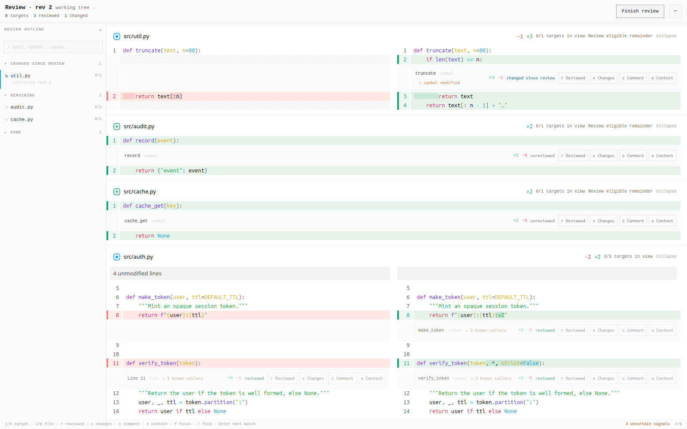
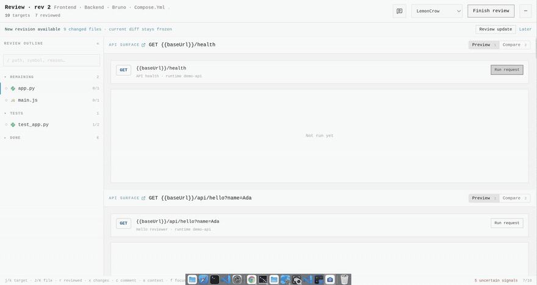
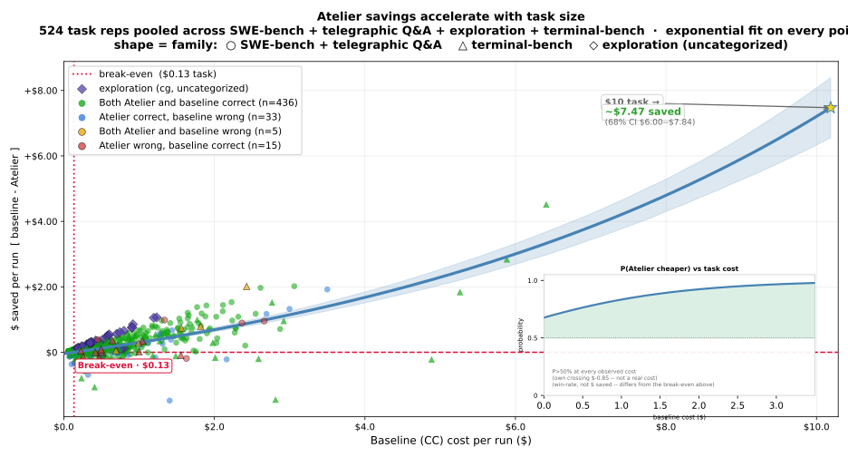

<!-- cspell:ignore Alamofire Excalidraw ast-grep codegraph ctags django jcodemunch nohit okhttp scip serena tokio vscode zoekt beasm Trendshift telegraphese -->

<div align="center">


# LemonCrow

### Add local code intelligence to the coding agent you already use

Runtime gives Claude Code, Codex, OpenCode, and Cursor useful local repository
intelligence and LemonCrow tools without replacing the agent. Hosted Runtime
adds deeper private retrieval; Enterprise Runtime puts that private Runtime in
customer-controlled infrastructure. Managed execution and cross-workspace
context are not yet available.

**LemonCrow has two connected products:** Runtime improves the agent's repository
context and tools. Review helps you understand the code your agents changed and
preserve human review state across revisions.



<sub>Real Review Reader · revision 2 · reviewed work preserved while changed and new work returns to the queue.</sub>

[](LICENSE)
[](https://github.com/lemoncrow-lab/lemoncrow/releases)
[](https://github.com/lemoncrow-lab/lemoncrow)

[Quick start](#quick-start) · [Runtime](#runtime-local-by-default) · [Review](#review-agent-changes) · [Results](#results) · [Privacy](#privacy) · [Reference](#reference)

</div>

---

<a id="install" name="install"></a>
<a id="quick-start" name="quick-start"></a>

## Quick start

Install LemonCrow:

```bash
curl -fsSL https://lemoncrow.com/install.sh | bash
```

The installer asks nothing. It installs Local Review: the `lc` client (`lc` and `lcr` are real executables, not shell aliases) and a loopback Review server on port 7420. No account or sign-in is needed. Pass `--hosted` (alias `--cloud`) for Hosted Review at api.lemoncrow.com instead, which needs an invited account; run `lc auth login` next. Runtime is fetched once, the first time you run `lc rt enable <host>` (`claude`, `codex`, or `opencode`). To pre-install it, pass `--product runtime` or `--product both`, adding `--agent <host>` to enable an agent. `--dry-run` prints the plan; `--url` and `--port` are the other flags. Environment overrides: `LEMONCROW_RELEASE_TAG`, `LEMONCROW_RELEASE_BASE_URL` (alternate asset base, for example `file://` for a local rehearsal), and `LEMONCROW_NO_LAZY_INSTALL=1` to disable the first-use fetch. Upgrading from an earlier release? Read the [behaviour changes](CHANGELOG.md#behaviour-changes-for-local-installs) first.

Give Claude Code, Codex, or OpenCode Local Lite tools in the current Git repo:

```bash
lc with claude
lc with codex
lc with opencode
```

Cursor is not configured by the installer or `lc rt enable`; today it needs a source checkout (`bash scripts/install_cursor.sh`, see [Cursor integration](docs/hosts/cursor-install.md)). Runtime Lite stays local through `lc with`, persistent host integrations, and `lc runtime index`. `lc code` is the Hosted LemonCrow-owned coding agent. A Pro plan grants Hosted Runtime access; it is not a local engine mode.

`lc with` is temporary. It adds the LemonCrow plugin to that launch and does **not** modify the agent's saved configuration, model, authentication, or settings. The repository index is incremental and persists under `.lemoncrow/workspace/`.

Like it? Keep Local Lite enabled for that host:

```bash
lc rt enable claude
lc rt enable codex
lc rt enable opencode
```

To use Hosted Runtime:

```bash
lc rt enable claude --hosted
```

Signing in does not change a local integration into hosted execution. Local Runtime Lite stays local. `lc code` is an explicit Hosted Runtime entry point.

Review what an agent changed:

```bash
lc review --open
```

Runtime and Review remain separate product surfaces: Runtime does not require
Review, and Review does not require Runtime. The installed client sends no
product telemetry; see [Privacy](#privacy).

---

<a id="runtime-local-by-default" name="runtime-local-by-default"></a>

## Runtime: local

Runtime Lite is the open-source local Runtime for Claude Code, Codex, OpenCode,
and Cursor. It gives the agent useful single-repository code intelligence and
LemonCrow's local coding tools while keeping the host's normal model,
credentials, and settings. Claude Code, Codex, and OpenCode support the temporary `lc with` path; Cursor's integration is installed from a source checkout.

| What you want | Command | Execution |
| --- | --- | --- |
| Try once | `lc with claude` | Ephemeral Local Lite |
| Keep enabled | `lc rt enable claude` | Persistent Local Lite configuration |
| Local index | `lc runtime index` | Local Lite |
| LemonCrow coding agent | `lc code` | Hosted Runtime |
| Hosted Runtime | `lc rt enable claude --hosted` | Explicit hosted opt-in |

Local Lite opens no LemonCrow listening port, starts no LemonCrow application server or daemon, requires no LemonCrow account, and uploads no repository source to LemonCrow. The persistent incremental repository index lives under `<repo>/.lemoncrow/workspace/`.

Local Lite is intentionally lightweight. It provides lexical/local repository
intelligence rather than pretending to be the private advanced engine. Start
local; add hosted infrastructure, deeper semantic/hybrid retrieval, team
policy, or enterprise deployment only when you need those capabilities.
Cross-workspace context outside Review is not yet available.

Architecture details: [Runtime Lite](docs/architecture/runtime-lite.md) and the
[OSS/private code-intelligence boundary](docs/architecture/oss-private-code-intelligence.md).

<a id="review-agent-changes" name="review-agent-changes"></a>

## Review agent changes

Coding agents can produce changes faster than a human can confidently review
them. LemonCrow treats human review state as the durable object instead of
asking a model to write another review summary.

Start with the local review reader:

```bash
lc review           # freeze the current change and open the Review Reader
lc review --staged  # exactly what you are about to commit
lc review --no-open # capture and print the Review URL without opening a browser
```

<p align="center">
  
</p>
<p align="center"><sub>Real <code>lc review --open</code> demo · diff → rendered UI preview → compare → review context.</sub></p>

Try it from a source checkout: `make review-demo` creates a throwaway demo repository with a prepared change and opens it in the Reader; `make review-demo-diff` shows that change. See [the demo guide](docs/reference/review-demo.md).

The review workflow is designed to answer:

- what changed and where should I start?
- which changed definitions affect code outside the diff?
- which session or authoring evidence is associated with the change?
- which tests or checks actually ran?
- what have I already reviewed?
- after the author changes the code, which of my prior judgments are still valid?
- which comments still need action?

LemonCrow does not turn those signals into `AI APPROVED` or `SAFE TO MERGE`.
Human judgment remains final.

### Review only what changed again

Review marks are attached to content rather than line numbers. If an agent adds
lines above something you already reviewed, that work stays reviewed. If the
reviewed content changes, LemonCrow puts it back in front of you.

In the Review Reader (`lc review`), press **Mark reviewed** on what you have
read and **Add comment** on a line. After the author or agent revises the
change, run `lc review` again: the Reader shows **Changed since your review**,
and **Copy feedback** (or **Send to agent**) hands every open comment to the
author.

The same loop is scriptable with the full Review CLI in a source checkout
(`uv run lc review ...`); the installed `lc` client does not carry these flags:

```bash
lc review --mark src/auth.py
lc review --comment "ttl is hardcoded" --on src/auth.py:L81
# author or agent revises the change
lc review --since-my-review
lc review --feedback
```

Comments are re-anchored only when the new location is unambiguous. Otherwise
they are reported as orphaned instead of being silently moved.

Review also exposes impact outside the patch, review ordering, provenance,
and recorded verification evidence. Missing evidence is reported as unknown;
LemonCrow does not synthesize a passing test status.

See the [10-minute review walkthrough](docs/reference/review-walkthrough.md) or
the [CLI reference](docs/reference/cli.md#reviewing-agent-written-changes).

---

<a id="results" name="results"></a>

## Results

The numbers below are fixed results from pinned end-to-end Runtime benchmark
runs, not live counters. They remain supporting proof for the Runtime product;
they are not a claim that Local Lite has identical retrieval quality to the
advanced engine. Full methodology and raw-run references are in
[BENCHMARKS.md](BENCHMARKS.md).

**~30% lower cost · ~25% faster · without sacrificing task quality**

<sub>SWE-bench Verified, same model and harness: 29.5% lower cost, 23.7% less wall-clock time, and 92.8% resolved vs 80.8% baseline.</sub>

| Benchmark | Baseline correct | LemonCrow correct | Baseline cost | LemonCrow cost | Cost delta |
| --- | ---: | ---: | ---: | ---: | ---: |
| SWE-bench Verified, 50 tasks × 5 reps | 80.8% | **92.8%** | $234.84 | **$165.45** | **29.5% cheaper** |
| SWE-bench Lite, 10 tasks × 5 reps | **98.0%** | 96.0% | $19.83 | **$17.51** | **11.7% cheaper** |
| SWE-bench Pro, 10 tasks × 5 reps | 88.0% | **90.0%** | $39.01 | **$30.61** | **21.5% cheaper** |
| Terminal-Bench 2.1, 89 tasks × 5 reps, Opus 4.8 | 78.9% | 78.9% | $73.75 | **$61.98** | **16.0% cheaper** |

The table includes the SWE-bench Lite regression: LemonCrow was cheaper on that
run but scored 2 percentage points lower. The benchmark set is not filtered to
keep only favorable results.

On SWE-bench Verified, the same pinned run used **37.7% fewer turns**, **23.7%
less wall-clock time**, **37.8% fewer tool calls**, and **27.9% fewer output
tokens**.

<p align="center">
  
</p>

The retrieval suite also contains advanced semantic-search measurements across
~7,200 query/answer pairs and 14 repositories. Those results describe the
advanced code-intelligence path, not Runtime Lite. Runtime Lite deliberately
uses a lightweight local lexical/indexed pipeline instead. See
[indexing and retrieval results](BENCHMARKS.md#indexing-time) for the full
comparison and caveats.

---

<a id="how-it-works" name="how-it-works"></a>
<a id="what-lemoncrow-does" name="what-lemoncrow-does"></a>

## How Runtime Lite works

`lc with` resolves the current Git worktree, prepares the incremental Lite index, and launches your normal coding agent with the LemonCrow plugin available for that run:

```text
Claude Code / Codex / OpenCode
            |
   LemonCrow plugin
            |
       Runtime Lite
            |
         your repo
            |
            +-- .lemoncrow/workspace/  (persistent local index)
```

There is no background LemonCrow daemon, listening Runtime port, or application server to keep running.

Key Local Lite tools include:

| LemonCrow tool | Local Lite purpose |
| --- | --- |
| `code_search` | Exact symbols plus indexed lexical, path/name, and import-aware search |
| `read` | Exact ranges and bounded local source reads |
| `edit` | Verified local file edits |
| `bash` | Bounded local command execution |
| `relations` / `graph` | Basic repository relationships and import map |
| `scan` / `codemod` / `blame` | Local repository helpers |

Runtime Lite deliberately excludes embeddings, ANN/vector search, Torch,
Runtime Lite deliberately excludes embeddings, ANN/vector search, Torch,
SentenceTransformers, a resident Zoekt server, and the heavy LemonCrow
application server. Advanced semantic/hybrid retrieval, richer ranking and
lineage, and shared infrastructure belong to the explicit Hosted/Enterprise
paths; cross-workspace context is not yet available. A Pro plan is an access tier for Hosted Runtime, not an execution mode.

Architecture details: [docs/architecture/runtime-lite.md](docs/architecture/runtime-lite.md).

---

## Supported hosts

The one-command Local Lite path is available for Claude Code, Codex CLI, and
OpenCode: `lc with claude|codex|opencode|pi`. Cursor is also supported through a LemonCrow integration installed from a source checkout. Pi and LemonCode are public managed coding-agent hosts under `lc rt host` (the installed client manages Pi; LemonCode host lifecycle needs the full CLI); using either host does not imply Hosted Runtime. LemonCrow also integrates with other hosts; capability depth
varies by what each host exposes. See
[all host integrations](docs/hosts/all-agent-clis.md) and the
[host capability matrix](docs/hosts/host-capability-matrix.md) before depending
on host-specific lifecycle or verification behavior.

---

<a id="other-capabilities" name="other-capabilities"></a>

## Other capabilities

These are useful, but they are not the core review workflow:

- **Remote MCP:** `lc rt mcp serve` (opt-in) exposes the current workspace through an OAuth-protected remote MCP endpoint for compatible clients. The gateway process runs Runtime Lite itself, or the hosted thin client when Runtime targets a hosted server; it never starts a local LemonCrow server.

The full LemonCrow CLI in a source checkout (`uv run lc ...`) adds these; the installed `lc` client says so instead of running them:

- **Session replay:** `lc session stats` and `lc session replay` inspect recorded agent sessions locally without rerunning the model.
- **Usage accounting:** `lc usage` reports recorded usage by host, model, project, and day without treating unknown pricing as zero.
- **Bring your own model:** `lc rt model` registers and probes OpenAI-compatible endpoints such as vLLM, Ollama, LM Studio, or an internal gateway.
- **Agents and skills:** packaged agent modes and optional skills live under [`integrations/`](integrations/).

Full commands and flags live in the [CLI reference](docs/reference/cli.md).

---

<a id="privacy" name="privacy"></a>
<a id="privacy-and-network-behavior" name="privacy-and-network-behavior"></a>

## Privacy

**Local Lite:** repository source, the Lite index, and local tool execution stay
on the developer machine. Local Lite requires no LemonCrow account and does not
upload repository source to LemonCrow. The coding agent still uses its own
configured model provider, so that provider's normal network behavior still
applies.

**Hosted Runtime:** deeper retrieval and richer code relationships run in LemonCrow-operated private infrastructure. Pro is the commercial plan that can grant access to this service. Cross-workspace context outside Review and managed model/provider routing and execution are **not yet available**; see [what Pro includes](docs/setup/pro-hosted-runtime.md#what-pro-includes).

**Enterprise Runtime:** the private Runtime runs in customer-controlled or dedicated infrastructure with identity, policy, workspaces, governance, and audit. Do not assume the local Runtime privacy boundary applies to either managed deployment.

**Telemetry:** the installed `lc` client and the Local Review server it
installs send no product telemetry. `lc audit` prints
`"product_telemetry": false`, and there is nothing to turn off.

The full LemonCrow engine you run from a source checkout (`uv run lc ...`)
sends anonymous aggregate telemetry, **on by default**. It contains aggregate
counts, bucketed durations, dollar estimates, hashed install/session
identifiers, version, host source, retrieval domain, and timestamps. It does
**not** contain source code, prompts, repository paths, file paths, or symbol
names. Turn it off in that checkout with:

```bash
uv run lc rt telemetry remote off
```

or set `DO_NOT_TRACK=1` / `LEMONCROW_TELEMETRY=off`. Commands you explicitly
run can still use the network, for example `lc update` downloading the release
installer or the coding agent calling its configured model provider. See
[privacy and network behavior](docs/setup/privacy.md) for the complete details.

---

<a id="limitations" name="limitations"></a>

## Limitations

- Benchmark results are measured on the published task sets; they are not a guarantee for your repository or model.
- Host capabilities differ. Features that depend on lifecycle hooks or live session capture may degrade to imported or manual evidence on some hosts.
- Linux with Python 3.13 is the release-qualified platform. macOS builds are published but not yet covered by release qualification, and Windows support is partial and not currently validated. See the [support matrix](docs/reference/support-matrix.md).
- LemonCrow does not run or pay for your model provider; you configure the provider or local endpoint you want to use.
- Runtime Lite is the public open-source local Runtime. Hosted/Pro/enterprise paths are separate explicit surfaces; none is required for Local Lite use.

---

<a id="why" name="why"></a>

## Why LemonCrow exists

I built LemonCrow after using coding agents heavily and seeing two bottlenecks
move into focus. First, agents repeatedly spent context and tool calls
rediscovering the same code. Once that became cheaper, the harder bottleneck was
human attention: the agent could change code faster than I could confidently
review it.

My background at Google included performance optimization and cost work, so the
runtime is measured at the whole-task level rather than by claiming a win on one
isolated hop. But the product direction is review-first: reduce how much a human
has to reread without outsourcing the engineering judgment.

---

<a id="reference" name="reference"></a>

## Reference

- [Installation](docs/setup/installation.md)
- [Review walkthrough](docs/reference/review-walkthrough.md)
- [CLI reference](docs/reference/cli.md)
- [Architecture](docs/reference/architecture.md)
- [Benchmarks](BENCHMARKS.md)
- [Full benchmark results](docs/benchmarks/results.md)
- [Host integrations](docs/hosts/all-agent-clis.md)
- [Host capability matrix](docs/hosts/host-capability-matrix.md)
- [Privacy & network behavior](docs/setup/privacy.md)
- [Troubleshooting](docs/setup/troubleshooting.md)

### Removal

Check state, update, and remove products with the client. Uninstall needs a
product and never prompts:

```bash
lc status
lc update                      # re-runs the installer for each installed product; host registrations are untouched
lc uninstall review            # or: runtime | all
lc uninstall all --dry-run     # preview
```

### Building from source

```bash
git clone https://github.com/lemoncrow-lab/lemoncrow
cd lemoncrow
make oss-dev    # the real installer on locally built assets, in the sandbox ~/.lemoncrow-oss
make oss-prod   # full rebuild, installed into ~/.lemoncrow
```

See [Installation](docs/setup/installation.md) for development setup details.

### License

[Apache-2.0](LICENSE). Runtime Lite, public contracts, and the auditable public
client are open source.

Hosted LemonCrow and the advanced Pro code-intelligence engine are separate
commercial/private surfaces and are not required for Local Lite. If you want to
discuss an enterprise deployment, contact <contact@lemoncrow.com>.

See [LICENSE](LICENSE) and [NOTICE](NOTICE).
