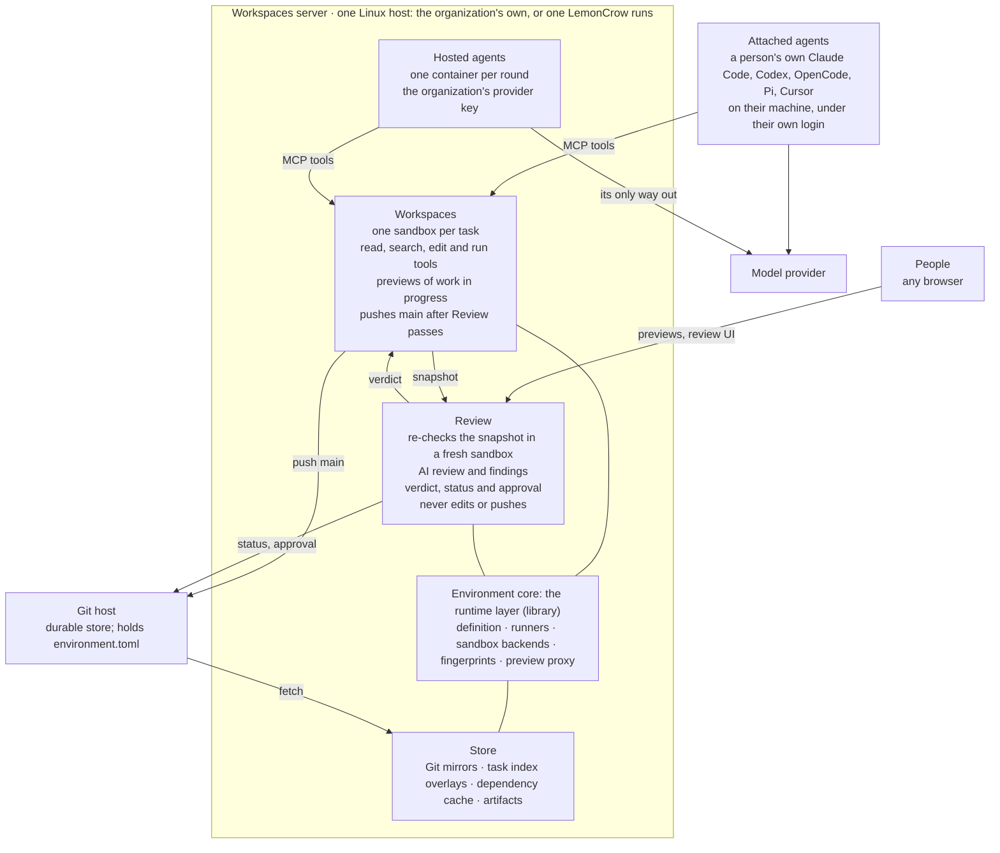

# LemonCrow Workspaces and Review: architecture

Status: accepted direction, 2026-11-08. Shipped: the environment definition and `lc verify` ([reference](../reference/environment.md)), Review reading the definition from the trusted base, the environment core package, local `lc task`, the server on one host (tasks, landing through Review, backups, history and repair), hosted agents (M7) and what the LemonCrow-hosted server needs (M8: per-person sign-in, the audit log, GitHub App credentials, one provisioned VM per organization). The M4 to M8 gates have not run.

## Products

LemonCrow is two products. **Workspaces** is the actor: it gives each agent task a place to work, serves the read, search, edit and run tools, checks the work, and lands it on Git. **Review** is the judge: it re-checks a change in a sandbox the author cannot touch and returns a verdict. It never edits or pushes.

Runtime is no longer a product. What shipped as Runtime (the local index, the MCP tools, `lc workspace`) is Workspaces Lite, Workspaces in local mode. The environment core (runners, sandboxes, the egress gateway, secrets, fingerprints, previews, caches) is the runtime layer both products are built on: a library that nobody buys or installs on its own.

Workspaces is the product wherever it runs: on a developer's machine (Workspaces Lite) or on the customer's own infrastructure (Enterprise) ([Deployment](#deployment)). On a server, the agent working a task is either attached, the person's own agent under their own login on their machine, or hosted, run by the server beside the task ([Agents](#agents-attached-or-hosted)). The task, its tools and its gate are the same either way.

| | Workspaces | Review |
| --- | --- | --- |
| Role | Runs tasks, edits files, lands work | Checks a change, gives a verdict |
| Reads the environment definition from | The task's own head | The trusted base (`main`) |
| Writes to Git | Commits and, in server mode, pushes `main` after Review passes | Never; status and approval only |
| Modes | Local (`lc` on a laptop); server: Enterprise, on the customer's infrastructure (planned) | Local (`lc review`), pull request (GitHub Action), hosted and self-hosted |
| Agents | Attached: the person's own, on their machine; hosted: run by the server beside the task (planned) | None that edits; its AI reviewer is of another model family when required |
| Exists today | Local mode: index, MCP tools, `lc workspace`, `lc verify`, `lc task`; server mode on LemonCrow's own internal server: landing through Review when `[review]` is configured (else the task's own checks), the server as the only Git credential holder, backups with a restore drill, history from the mirror, post-merge repair (bisect and a guarded revert task) | Yes, and Workspaces snapshots as a source |

## Principles

1. **One definition per repository.** `.lemoncrow/environment.toml` sets up agent sandboxes, previews, pre-push checks and review. A repository is set up once.
2. **The author never certifies itself.** Review runs in a fresh sandbox, from the definition on the trusted base. Nothing a task's sandbox produced counts as evidence that approves it.
3. **Git stays the store.** GitHub (or any Git host) is the durable record. The server is a cache and an actor in front of it, not a replacement for it.
4. **Only Workspaces pushes.** In server mode agents hold no Git credential, so the gate cannot be skipped even where the Git host has no branch protection.
5. **Unlanded work is never lost.** A reclaimed sandbox first saves its work as a ref in the mirror.
6. **Local mode always works.** Every server feature is something a team adopts; `lc` on a laptop with no server stays a complete product.

## System



Both products import the environment core; neither imports the other. Workspaces reaches Review only as a separate process (`pro/workspaces/review_gate.py`: the snapshot as JSON on its standard input, the verdict on its standard output), so the server process loads no Review module. In local mode the same pieces run on the developer's machine: Workspaces is `lc` with its index and tools, and Review is `lc review`.

## The environment definition

`.lemoncrow/environment.toml` says how to build, run, check and preview a repository, and belongs to neither product. `.lemoncrow/review.yaml` keeps only review policy (surfaces, check policy, landing, browser checks) and refers to checks and services by id.

It is TOML because the public client is standard-library only (asserted by `client/tests/test_packaging_audit.py`) and Python ships `tomllib`. `review.yaml` stays YAML: it is policy, read only by the Review engine.

```toml
version = 1

[toolchain]
image = "ghcr.io/example/toolchain-node22@sha256:<digest>"

[[dependencies]]
lockfile = "package-lock.json"
install = "npm ci --no-audit --no-fund"

[services.postgres]
image = "postgres:16@sha256:<digest>"
ready = "pg_isready -U postgres"

[[checks]]
id = "typecheck"
paths = ["*.ts", "*.tsx", "tsconfig*.json", "package.json"]
run = "npm run -s typecheck"

[[checks]]
id = "tests"
paths = ["src", "tests", ":!docs"]
needs = ["postgres"]
run = "npm test"

[previews.web]
run = "npm run dev -- --port \"$PORT\""
ready = "/"

[needs]
network = ["api.example.com"]
secrets = ["EXAMPLE_API_KEY"]
```

| Section | Meaning | Read by |
| --- | --- | --- |
| `checks` | `id`, `paths` (Git pathspecs), `run` (a shell command) | `lc verify`, task sandboxes, Review |
| `toolchain` | Base image, pinned by digest | Sandboxes, environment fingerprint |
| `dependencies` | Lockfile and install command | Sandboxes, Review's hermetic fetch |
| `services` | Image and readiness probe; a check lists the ones it `needs` | Sandboxes, Review's run stage |
| `previews` | Command and readiness path | Workspaces previews, Review's interactive preview |
| `needs` | Hosts and secret names the repository asks for | Workspaces grants them within the organization's ceiling; Review grants none |

**Rules**

1. **The schema is versioned and strict.** Unknown keys are refused. A section is accepted only once something reads it; all the sections above are read today.
2. **A check runs when the change touches its `paths`.** The paths are Git pathspecs, so exclusions such as `:!docs` work and matching is Git's own. A deletion counts as a touch. The command runs from the repository root with `$LC_CHANGED` naming a file that lists the changed paths that still exist, one per line.
3. **The repo asks; the product grants.** `needs` only names hosts and secrets. A sandbox gets them only if the organization allows them, and Review's sandbox gets none.
4. **Review reads the trusted base, Workspaces reads the task's head.** An agent can add a check and try it at once; Review uses it only after it lands on `main`, as `trusted_base.py` already enforces for `review.yaml`.
5. **Images are pinned by digest.** The digests feed the environment fingerprint; an unpinned image makes the fingerprint unreproducible, and Review says so.
6. **Migration.** While repositories migrate, Review still reads `runtimes`, `check_recipes` and `interactive_preview` from `review.yaml` when `environment.toml` lacks the matching section.

## Environment core

Most of the core already exists. `review/` is `src/lemoncrow/pro/capabilities/review/` and `environment/` is `src/lemoncrow/pro/environment/`, the package both products import. The definition parser lives in the public client (`lemoncrow_client.environment`) so `lc verify` needs no server.

| Piece | Today | Becomes |
| --- | --- | --- |
| Definition | `lemoncrow_client/environment.py`: checks, toolchain, dependencies, services, previews, needs; the fingerprint and the `lc verify` record | One parser for both products |
| Runner plugins | `environment/runners.py`: `command` in bubblewrap with no network; `http-service` within one run, after replaying a Bruno request's plain `await bru.runRequest(...)` pre-request steps on the same service (a request with any other pre-request script is refused, and one whose steps are not all `GET`/`HEAD`/`OPTIONS` is never auto-compared). Review's stages, snapshot and evidence reach them through `environment/runner_host.py` (the core imports nothing from Review). `environment/services.py` keeps declared services up through a run; `environment/oci.py` is their backend (rootless Podman, else rootless Docker), and a check with a pinned toolchain runs in that image | Shared |
| Host sandbox pieces | `environment/host_tools.py`, `environment/sandbox_limits.py`, `environment/macos_sandbox.py` | Shared |
| Hermetic sandbox | `review/hermetic.py`: fetch, offline build, offline run; npm and Python lockfiles; an npm cache for the run stage | Review's backend |
| Task sandbox | `environment/oci.py` and `environment/egress_gateway.py`; `pro/workspaces/sandbox.py`: one rootless container per task from `toolchain`, services on an internal network, egress only through an allowlisting gateway, the index in its own container | One per task; microVMs when several people share a server |
| Previews | `review/interactive_preview.py`, `environment/preview_proxy.py`, `environment/preview_state.py` | Shared preview and one-time-ticket proxy |
| Execution identity | `environment/execution.py`: executor classes (including `workspace_task`), environment fingerprint | Shared |
| Dependency cache | `environment/dependency_cache.py`: tarballs by sha512, per trust level | Shared, under the rule in Data |
| Jobs | `enterprise/server/.../hosted_jobs.py`: durable jobs, fenced leases | Scheduler once tasks outgrow one host |

## Workspaces

**Local mode (today).**

- **Index:** the per-repository SQLite index with worktree overlays (`client/src/lemoncrow_client/lite/index.py`).
- **Agent tools:** the MCP tools `read`, `code_search`, `edit` and `bash`.
- **Multi-repo commands:** `lc workspace status|branch|commit|push|pr|graph|impact` for every repository in a folder.
- **Checks:** `lc verify` runs the checks a change touches, by hand or from a pre-push hook.
- **Tasks:** `lc task start|land|finish|list` makes, lands and removes task worktrees in one repository or several, each with its index overlay built at start and removed with the worktree.

**A task, in either mode.**

1. **Start.** `lc task start <id> [--repos a,b]` makes a worktree per repository at the base branch, on a local branch `agent/<id>`, with an index overlay. In server mode it also builds the sandbox from `environment.toml`, installs dependencies from the shared cache and starts the declared services.
2. **Work.** The agent uses the tools above. In server mode they run inside the sandbox, history queries (blame, log, merge base) come from the mirror, and the person gets a preview link. The sandbox's files are the only copy: edits through the tools and writes by `npm install` or a formatter land in the same place, and the index picks up both.
3. **Verify.** `lc verify` runs the checks the change touches. It is fast feedback for the agent and counts as self-reported, never as review evidence.
4. **Land.** Workspaces commits, rebases onto the latest base and, in server mode, sends the snapshot to Review. On a pass it pushes `main` as a fast-forward; if `main` moved, it rebases and re-sends only when the rebase changed files a check covers. On a fail the findings go back to the agent.
5. **Finish.** The worktree, sandbox and services are removed. Work that has not landed is first saved as `refs/lemoncrow/tasks/<id>` in the mirror.

A task that spans repositories lands each one only after all of them pass, in the order `lc workspace graph` gives (a provider before its consumer).

## Agents: attached or hosted

Where the agent runs is chosen per task, not per deployment. Either way the task is the same: the same sandbox, tools, previews and checks, and the same land through Review. The task records the agent (`host` and `model`) in both cases, so Review's independence rule applies to both. In local mode every agent is attached and its tools are local; the table is about a task on a server.

| | Attached agent | Hosted agent (M7) |
| --- | --- | --- |
| What it is | The person's own Claude Code, Codex, OpenCode, Pi or Cursor | An agent the organization configured on the server, in an image pinned by digest: Claude Code built in, any other through a command |
| Runs on | The person's machine | The Workspaces server, in a container of its own for each round, beside the task's sandbox |
| Started by | The person: `lc task start <id> --server URL --host claude` registers the `lc task mcp` bridge in their agent, or `lc task claude <id> --server URL` (or `codex`) runs that agent with the task's tools only | The server, from a goal given when the task starts or later (`lc task run`) |
| Model access | The person's own login or key, on their machine | The organization's provider key, from the secret broker, in the agent's process environment only |
| Reaches the tools | Through `lc task mcp`, a local bridge to the task's MCP endpoint | Through a relay on the agent runner's standard input and output; the server answers each call with the task's tools, holding no token in the container |
| Network | Whatever the person's machine has | The model provider's hosts, through a gateway of its own; nothing else, not even the server's API |
| Its own file and shell tools | Still there, on the person's machine; the task's files are only in the sandbox | Turned off: every read, edit and command goes through the task's tools |
| Lands | When the person or the agent runs `lc task land` | When the agent exits cleanly, or when a person lands it, as the start request says |

Rules for hosted agents:

1. **The agent container is not the sandbox.** It holds the model key and nothing else: no task token, no repository files, no Git credential, none of the repository's `needs.secrets`. The sandbox never holds the model key. Text in the repository that steers the agent can reach only what the agent can: the provider and the task's tools.
2. **Subscription logins stay on the person's machine.** A personal Claude login is used only by an attached agent. Anthropic does not allow a third-party product to offer claude.ai login for the agents it runs unless approved ([Agent SDK overview](https://code.claude.com/docs/en/agent-sdk/overview)), so a hosted agent uses an API key: the organization's own Anthropic, Bedrock, Vertex or OpenAI key.
3. **The organization chooses agents, not the repository.** Agents, their images, commands, provider hosts and key names are in the server's configuration. `environment.toml` cannot name an agent or a key.
4. **Every run is bounded.** Wall-clock time and spend per run, and how many hosted agents run at once (`max_agents`). A run that reaches a bound stops, says which, and its work is saved as for any task.
5. **Review's findings go back to the agent.** On a fail the findings are the agent's next message, for a bounded number of rounds; then the task waits for a person.
6. **A person can take over, and give back.** A hosted agent can be stopped and a person's own agent attached to the same task, and the reverse; the task, its files and its record do not change.

## Review

Review gains one new source of changes and one new runner; its rules stay as they are.

- **Sources.** Pull requests, as today, and Workspaces snapshots (`review/sources/workspaces.py`): an exact tree plus its base commit, read from the mirror, with no pull request needed. Review checks that the head's tree is the snapshot's and that the head descends from the base.
- **Run.** Review loads `environment.toml` from the trusted base, picks the checks the change touches, and runs them through the hermetic fetch, build and run stages, stamped `managed_sandbox`; a check with a pinned toolchain runs in that image under the OCI backend, and one that did not counts as not run. Declared services start inside the offline run stage and stay up for the run.
- **Independence.** The reviewer must be a different model family from the task's agent when `independence.py` is set to `require`. The agent comes from the task's own record (`lc task start --host --model`), and the family Review derives is kept on the task.
- **Verdict.** The commit-status rule: fail on a P0 (a failing check is one), or on a P1 when the base's `review.yaml` sets `review.fail_on: p1`, and fail closed when the review is incomplete.
- **Fingerprint.** Review compares its environment fingerprint with the one the task's `lc verify` recorded, so "passed for the agent, failed for Review" points at the environment first: the verdict's reason starts with "environment differs".

Unchanged: Review never edits or pushes, the pull-request integration works as today, and a change to `environment.toml` never applies to its own review.

## Trust, isolation and secrets

The two sandboxes come from the same definition but differ in what they may touch. A task's sandbox trusts its own author; Review's trusts nothing it checks.

| | Task sandbox (Workspaces) | Review sandbox |
| --- | --- | --- |
| Code it runs | The agent's own work in progress | The snapshot, treated as untrusted |
| Definition from | Task head | Trusted base |
| Files | Writable worktree | Read-only snapshot |
| Network | Registries and hosts in `needs.network`, within the organization's ceiling | Registries during fetch only; build and run offline |
| Email and webhooks | Sent, to declared hosts only | Captured by recording sinks, never delivered |
| Secrets | Names in `needs.secrets`, injected at start, never written to disk | None |
| Lifetime | The task, hours to days; idle tasks suspend | One run, minutes |
| Isolation | One rootless container per task | bubblewrap stages on Linux, or a container of the pinned toolchain per check |
| Executor class | `workspace_task`, self-reported | `managed_sandbox` |
| Git | No credential; objects of branches, tags and its own base only (the published store), never other tasks' saved work | Read only, from the mirror |

- **Services without the Docker socket.** Workspaces starts each task's services itself and gives the sandbox network access to them only. Handing a task the host's Docker socket would give it root on the host.
- **Previews only through the proxy.** The proxy hands out one-time tickets per preview; nothing listens on a public interface.
- **The agent runs outside the sandbox.** An attached agent talks to its model provider from the person's machine; a hosted agent from its own container, whose only way out is the provider. Either way its commands and edits run inside the sandbox, which therefore never holds the model key.

## Data and retention

Only downloads addressed by their hash cross between the products, because every reader re-checks the hash. Anything a sandbox produced stays on its own side, so a task can never plant code that Review then runs.

| Store | Keyed by | Shared | Closed by |
| --- | --- | --- | --- |
| Git mirror, one per repository | Repository | Both read; only Workspaces writes refs | Kept; scheduled `git gc` |
| Published store, one per repository: branches, tags and task bases from the mirror | Repository | Task checkouts and sandboxes borrow its objects | Refreshed at every fetch and push; scheduled `git gc` |
| Review's snapshot verdicts | Repository and head | Review writes; in the backup | The newest 200 per repository |
| Restore drill records | Time | Workspaces only | The last 20 |
| Task worktrees and index overlays | Task id | Workspaces only | Removed at finish |
| Saved task refs `refs/lemoncrow/tasks/<id>` | Task id | Workspaces only | Deleted when the task lands or a person discards it; in the backup |
| Post-merge repair records and sandboxes | Pushed commit | Workspaces only | Sandbox removed after each repair; records after `repair.keep_days` (30) |
| Downloaded packages | sha512 or sha256 of the file | Yes, verified on every read | Idle-time pruning (`hermetic.py`) |
| npm cache: links to those packages in npm's layout | Lockfile integrity hash | Within one trust level; npm verifies on every read | Idle-time pruning, the same 30 days (`hermetic.py`) |
| Installed dependency trees | Lockfile digest, toolchain, trust level | No | At most 8 trees per trust level |
| Preview builds | Content key | Within one product | 32 builds, 1 h idle grace, 3-day TTL |
| Execution results and artifacts | Execution identity | Review owns; a task reads its own | `execution.retention_days`; summaries kept |

Both products compute the environment fingerprint with the same code: image digest, toolchain, lockfile digest and check digest.

## Deployment

Workspaces is the product wherever it runs. On a server the agent can be attached or hosted. The server is not offered as a self-run download: it runs only within Enterprise.

- **Workspaces Lite:** `lc` on any developer machine; no account, no server. Every agent is attached. It is open source.
- **LemonCrow's own server:** LemonCrow runs one Workspaces server for its own organization only; it is not offered to customers. Workspaces Pro (`lc rt enable <host> --hosted`: remote MCP and hosted retrieval) is a different offering, with no tasks or sandboxes.
- **Enterprise (planned):** the same server on the customer's own infrastructure, with its identity provider, secrets store and audit pipeline. Linux, because Review's hermetic stages use bubblewrap. Task sandboxes and their services are rootless containers. Outbound traffic stays within the organization's ceiling.
- **Backups:** mirrors can be rebuilt from the Git host; the server backs up saved task refs, task records and Review's records, and a restore drill restores one into an empty store. The server refuses to run as the only push credential holder (`git.sole_push_credential`) until a drill passed. Each `lc verify` in server mode also saves the task's work in progress to its ref.
- **Later:** tasks become durable jobs on worker hosts through the existing job queue, and per-task microVMs replace containers when several people or organizations share a host.

## Naming

- The product is **Workspaces** wherever it runs: Workspaces Lite is local mode, Workspaces Pro is hosted retrieval, and Enterprise runs the server on the customer's own infrastructure (Enterprise Workspaces in [the product model](runtime-lite.md#product-model)). Workspaces Pro (once called "Hosted Workspaces" and "Hosted Runtime") is not this server. **Review** is the other product. `lc workspace` is Workspaces' multi-repository command group, not a different thing.
- The environment core is the runtime layer both products are built on. It has no product name of its own.
- `lc runtime` and `lc rt` stay as compatibility spellings; user-facing text says Workspaces, Workspaces Lite (local), Workspaces Pro (hosted retrieval) and Enterprise. `runtime` stays the internal product key, and `install.sh --product workspaces` is the spelling of `--product runtime`.

## Prior art

- Anthropic, [Redesigning source control at Anthropic](https://www.anthropic.com/research/redesigning-source-control) (2026-10-13): always-online clients, server-side history queries, sparse checkouts, post-merge testing instead of a merge-queue lock.
- LemonCrow's own local multi-repository workspace (`lc workspace`), which this builds on.
