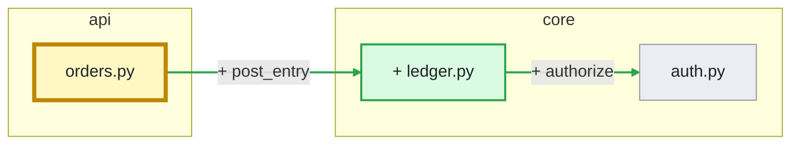

# GitHub Action: AI pull request review

LemonCrow reviews each pull request in your own CI, on your own model key, and posts the result as a bot: one summary comment with a verdict, inline comments on the lines that matter, and a `LemonCrow Review` commit status on the head commit. On each push it re-reviews only what changed. Early access.

Nothing is sent to LemonCrow. The Action runs `lc review --pr N --ai --publish-bot` on your runner and talks only to GitHub and to the model provider you give it a key for. You pay your provider directly; LemonCrow adds no markup.

## Install the GitHub Action

1. Add your model key as a repository secret: `ANTHROPIC_API_KEY` or `OPENAI_API_KEY`.
2. Add this workflow as `.github/workflows/lemoncrow-review.yml`:

```yaml
name: LemonCrow Review

on:
  pull_request:
    types: [opened, synchronize, reopened, ready_for_review]
  # Chat: answer `@lemoncrow` in the pull request's conversation and in review threads. Delete these two entries
  # (and the `if:` below) for a review-only install. See "Chat in pull request threads".
  issue_comment:
    types: [created]
  pull_request_review_comment:
    types: [created]

permissions:
  contents: read
  pull-requests: write
  statuses: write

# A push cancels the review of an older push. A comment never cancels anything: each one has its own group.
concurrency:
  group: lemoncrow-${{ github.event_name == 'pull_request' && format('review-{0}', github.event.pull_request.number) || format('chat-{0}', github.event.comment.id) }}
  cancel-in-progress: ${{ github.event_name == 'pull_request' }}

jobs:
  review:
    runs-on: ubuntu-latest
    timeout-minutes: 15
    # Start a runner for a comment only when it mentions the bot (comments on plain issues never reach the Action).
    if: >-
      github.event_name == 'pull_request'
      || (github.event_name == 'issue_comment' && github.event.issue.pull_request && contains(github.event.comment.body, '@lemoncrow'))
      || (github.event_name == 'pull_request_review_comment' && contains(github.event.comment.body, '@lemoncrow'))
    steps:
      - uses: actions/checkout@v4
        with:
          fetch-depth: 0
      # Pin a full commit SHA of the public repository (see "Installing a pinned version" below), not a branch or a
      # tag that moves: the commit is the version that reviews, and the prompt and checks come with it.
      - uses: lemoncrow-lab/lemoncrow@<commit-sha>  # pin to a release commit
        env:
          ANTHROPIC_API_KEY: ${{ secrets.ANTHROPIC_API_KEY }}
          # or: OPENAI_API_KEY: ${{ secrets.OPENAI_API_KEY }}
        with:
          # Advisory while you trial it: the check reports P0s but never fails. Once you have seen a few weeks of
          # pull requests and agree with the P0s it raised, change this to `p0` to fail the "LemonCrow Review"
          # check while a P0 is open (add the check to branch protection if you want it to block merges).
          fail-on: none

      # If the job is killed (timeout) or cancelled before the review finishes, the status it set to `pending` would
      # stay pending forever. This step runs only then, and turns a still-pending status into an error. It is for a
      # review (a push); a comment sets no status.
      - name: Do not leave LemonCrow Review pending
        if: (failure() || cancelled()) && github.event_name == 'pull_request'
        env:
          GH_TOKEN: ${{ github.token }}
          REPO: ${{ github.repository }}
          SHA: ${{ github.event.pull_request.head.sha }}
        run: |
          state=$(gh api "repos/$REPO/commits/$SHA/statuses" \
            --jq '[.[] | select(.context == "LemonCrow Review")][0].state // ""')
          if [ "$state" = "pending" ]; then
            gh api --method POST "repos/$REPO/statuses/$SHA" \
              -f state=error -f context="LemonCrow Review" \
              -f description="The review job failed or was cancelled before it finished. Re-run it." \
              -f target_url="$GITHUB_SERVER_URL/$REPO/actions/runs/$GITHUB_RUN_ID"
          fi
```

3. Open a pull request. The bot posts a summary comment and a `LemonCrow Review` status when the run finishes.

Notes on the workflow:

- **`permissions`** are the least the Action needs: `pull-requests: write` to comment, reply in threads and resolve threads, `statuses: write` for the status, `contents: read` to fetch the pull request. Chat adds no permission (see "Chat in pull request threads"). It posts as `github-actions[bot]` with the workflow's `GITHUB_TOKEN`; keep the default `github-token` input so the comments never come from a person.
- **`timeout-minutes`** bounds a hung model call; each call has its own 120-second limit, so a review that is not done in a few minutes is stuck. A large pull request can also run long: at Deep depth up to ten calls run one after another.
- **The last step** (`if: (failure() || cancelled()) && github.event_name == 'pull_request'`) is the fallback for a killed job. The Action sets `LemonCrow Review` to `pending` when it starts, and a job that is cancelled or times out never gets to replace it, which would leave a required check waiting for good. The step looks at the status on this run's head commit and, only if it is still `pending`, sets it to `error` with a message to re-run. It touches only its own commit, so a run that a newer push cancelled marks its own, older commit and nothing else. It is `error`, not a pass, on purpose: a review that never finished has not approved anything; change `-f state=error` to `success` if you would rather it stay out of the way. GitHub runs a `failure()` or `cancelled()` step after a timeout in the normal case; if the runner itself is lost, nothing can run, and the status stays pending until the next push or a re-run.
- **`concurrency`** per pull request with `cancel-in-progress` means a newer push cancels the review of an older one instead of queueing behind it. A comment gets a group of its own (its comment id) and never cancels or is cancelled, so a question asked while a review runs is answered, and a push is not cancelled by a question.
- **`fetch-depth: 0`** gives LemonCrow the history to find the merge base. `ready_for_review` is in `types` so a draft is reviewed when it is marked ready.
- **`<commit-sha>`** is a placeholder: replace it with the full 40-character SHA of a commit of the public `lemoncrow-lab/lemoncrow` repository. There is no moving `v1` tag, on purpose. The Action installs LemonCrow from its own checkout at that ref, so the version you pin is the version that reviews, and a floating ref would change the prompt under you. See "Installing a pinned version".
- **Organization policy.** If your organization restricts which actions may run, allow `lemoncrow-lab/lemoncrow` and `astral-sh/setup-uv`; the Action uses the latter to install LemonCrow's dependencies (`uv` itself is pinned to an exact version). If it requires every third-party action to be **pinned to a commit SHA**, the Action already pins `astral-sh/setup-uv` to the commit of its `v5.4.2` tag. The sample workflow's `actions/checkout@v4` is a tag pin too; pin it to a SHA if your policy needs that.
- **GitHub rate limits.** When GitHub throttles a call (HTTP 429, or a 403 that names a secondary rate limit), the Action waits and tries again up to three times (5, 15 and 45 seconds, or the wait GitHub states, at most 60 seconds each), and never more than 120 seconds in total in one run. A permission error (`Resource not accessible by integration`) is not a rate limit and is not retried. If the limit outlasts that, the one write that was refused is reported in the run's notes and the next push repeats it.
- Runners: Linux and macOS (the install is POSIX shell); Windows runners are not supported. The key must reach the step as an environment variable; the Action never prints it.

### Inputs

| Input | Default | Meaning |
| --- | --- | --- |
| `github-token` | `${{ github.token }}` | Token the bot comments with. |
| `model-provider` | `auto` | `anthropic`, `openai` or `litellm`. `auto` uses `ANTHROPIC_API_KEY`, else `OPENAI_API_KEY`, from the step's environment. |
| `model` | the provider's own | Model id (also `LEMONCROW_REVIEW_MODEL`). OpenAI defaults to `gpt-4o-mini`; Anthropic to `claude-sonnet-4-6`. Both are provisional until review cost per catch is measured. |
| `depth` | `auto` | `auto`, `thorough` or `deep`. `auto` follows `review.effort` in `.lemoncrow/review.yaml` (Auto by default, `quick` if you set it there); the others go deeper for the run. It is also the depth of an `@lemoncrow review` comment that names none. |
| `fail-on` | `none` | `p0` fails the `LemonCrow Review` status while a P0 finding is open. The pull request's author cannot dismiss a P0 (see "Learning from feedback"). |
| `max-usd-per-pr` | none | Stop reviewing a pull request once its reviews have cost this many US dollars in total (a number such as `2.50`). See "A budget per pull request". |
| `max-runs-per-pr` | none | Stop reviewing a pull request after this many reviews of it (a whole number such as `5`). |
| `review-drafts` | `false` | Review draft pull requests too. |
| `on-push` | `true` | Re-review on each push to an open pull request. `false` reviews only when it opens. |
| `diagram` | `auto` | `auto` adds the collapsed `Change diagram` to the summary when the pull request added or removed a relationship between files; `off` never builds it. See "Change diagram". |
| `mention-aliases` | none | Extra handles the bot answers to besides `@lemoncrow`, comma separated (`@review-bot`). See "Chat in pull request threads". |
| `chat-allowed-associations` | `OWNER,MEMBER,COLLABORATOR,CONTRIBUTOR` | Whose mentions are answered, and whose reactions, replies and resolved threads teach the bot, by the `author_association` GitHub puts on the comment. |
| `pr-number` | the event's pull request (also for a comment on one) | Set it for `workflow_dispatch` runs. |
| `working-directory` | `.` | Where the repository is checked out. |

LiteLLM users can set `model-provider: litellm` and the variables LiteLLM already reads for their cloud (`AWS_*`, `AZURE_*`, `VERTEXAI_*`) plus `LEMONCROW_LITELLM_MODEL`. `LEMONCROW_LLM_BACKEND` is respected if you set it yourself. The intelligence policy and its kill switch (`intelligence.enabled` in the LemonCrow settings, `LEMONCROW_ROOT` on a self-hosted runner) apply exactly as they do locally: when AI is off, the run exits 0, posts no comment, and sets the `LemonCrow Review` status to `skipped: AI review is turned off`.

## What the bot posts

**One summary comment**, found and updated in place by a hidden marker (`<!-- lemoncrow:summary v1 -->`), so a push edits it instead of adding another:

- a verdict line that agrees with the status: `1 must-fix before merge`, `Partially reviewed: 2 of 3 risk signals examined` when the review finished but left risk signals unexamined, `Review incomplete: <why>` when it could not finish, or `No must-fix findings` only when every risk signal was examined;
- a status strip: `Re-reviewed 38 changed lines · 1 new · 2 carried forward · 1 fixed since last review`;
- findings sorted by severity, each linking to its inline thread and, when it cites a rule or an excerpt of another file, ending in an attribution trailer (see "Attribution trailers"). **P0** must fix, **P1** should fix, **P2** optional;
- P2 findings in a collapsed block, `N low-priority findings held back`;
- a collapsed `Change diagram` of the relationships the pull request added, removed or changed (see "Change diagram");
- on a clean review, a collapsed `What we checked`: files, rules applied, depth;
- collapsed blocks for feedback: `N findings dismissed by feedback`, `N instructions learned on this pull request` and `Suggested rules from feedback` (see "Learning from feedback");
- a collapsed `Fix with your agent`: a prompt listing the open findings with `file:line`, and the checked replacement for each finding that has one, to paste into Claude Code, Codex or Cursor;
- a footer with the model, depth, model calls and tokens, how much of those tokens was repository context (`~3k of it repository context`, see below), and an estimated cost when LemonCrow's local price table knows the model. It never guesses a price: an unknown model shows tokens only.

**Inline comments** for P0 and P1 findings: a title with the badge, why, the consequence, a one-click GitHub `suggestion` block only when the finding carries a fix LemonCrow has checked against the commit (see [Suggested fixes](#suggested-fixes)), and a one-line trailer naming the rule and the context it relied on, when there are any (see [Attribution trailers](#attribution-trailers)). P2 findings stay in the summary.

**Where a comment sits.** The investigator names the line, or short range (at most 8 lines), of the new file that the defect is on, and LemonCrow checks the claim before it places a comment by it: the lines must exist in the file at the reviewed commit, be lines the model was shown, and sit inside one hunk of the pull request's diff (the lines GitHub lets a comment attach to; GitHub's own diff is checked again when the comment is posted). If the claim fails any check, or the model named no line, the comment falls back to the first lines of the code the pull request changed in that function or file, which may not be the line that is wrong. The hidden state records which happened as `anchor`: `cited` or `target`. A comment cannot move once it is posted, so a finding that already has a thread stays on the lines the thread is on in the summary and the fix prompt, however the code shifts under later pushes; a finding with no thread follows its code.

A hidden JSON block closes the summary (see below), and every inline comment carries `<!-- lemoncrow:finding <id> -->` and `<!-- lemoncrow:fingerprint fp-… -->`. The fingerprint (category, code and rules) does not change when the model words the same problem differently. It is what stops a duplicate: right before posting, the bot looks for its own earlier comment on the same file with the same fingerprint, and if there is one it adopts that comment as the finding's thread instead of posting a second. That covers a run that `concurrency` cancelled after it posted a comment but before it saved the summary, which carries the state; a comment whose finding was closed (the bot replied that it was fixed) or that belongs to another finding is not adopted, so a bug that comes back, or a second bug in the same function, still gets its own comment.

Findings are AI output, so they are never posted as an approval or a change request: the bot's reviews use event `COMMENT` only, and human review state stays human. Anything the model wrote is neutralised before it is posted: it cannot forge the markers above, mention people, load images or open HTML blocks.

### Severity

One rule gives each finding its severity, and everything the bot shows reads that one answer: the badge on the inline comment, the verdict line, the held-back block, the `LemonCrow Review` status and `fail-on`. They cannot disagree, because none of them computes its own.

| Level | Meaning | What puts a finding there |
| --- | --- | --- |
| **P0** | Must fix before merge: a wrong result, a security hole, data loss | A violation of a rule you wrote in `.lemoncrow/review.yaml` (a critical rule) that cites that rule, or a **verified** finding the investigator rated **high** in the `correctness`, `security` or `persistence_migration` category. |
| **P1** | Should fix | Every other **high** finding (not verified, or in concurrency, API, performance and the like), and **medium** findings that are verified. |
| **P2** | Optional | Everything else, including every finding rated **low**, and a medium one with nothing but the changed code behind it. |

- **Rated** is the investigator's own `low`, `medium` or `high` for the impact of the defect on the code it cites. It only nominates a finding: it can lower one, and it can never make one P0 on its own. Its wording is never read, so a title that says "critical" changes nothing.
- **Verified** means evidence from beyond the finding's own changed code backs it, evidence the model did not write: a recorded check, an attached artifact, a static-analysis result, or an excerpt of a *different* file from the repository context pack (a caller the change breaks, a test, a definition). The finding's own changed unit and the exact source of that same unit do **not** count, because every changed unit comes with both and the model is shown those bytes anyway; neither does an excerpt of the finding's own file, or a related repository. A model's rating of `high` with nothing but the changed code behind it is therefore a **P1**, never a P0, and so never fails the check. What the Action can corroborate today is mostly the pack: it runs no scanner and records no checks of its own, so a P0 needs a finding whose cause the pack shows in another file (the stale caller of a function whose behavior the change broke), or a rule you wrote. Expect P0 to be rare; that is the point.
- **Unrated** findings (a model that gave no rating) keep the severity of their category: P1 for correctness, security, concurrency, persistence and API findings, P2 for performance and verification. Unrated is never low and never P0.
- A finding carried forward whose re-check failed on a push is **unverified** until a later check succeeds, so a P0 drops to P1 meanwhile. That review is incomplete, so with `fail-on: p0` the status is `error`, not a pass. A critical rule keeps its P0: your rule, not the model, made it a gate.
- **Rules**: every rule you write in `.lemoncrow/review.yaml` is a critical rule, and a violation is P0 only when the finding cites the rule it violates, which the Action requires of every rule finding. A rule imported through `import.rules_files` is **advisory**: its violation is P1 or P2 and never P0, unless `import.critical` in `.lemoncrow/review.yaml` lists it (see [Importing review rules](#importing-review-rules)). A finding that names no rule is held to the ordinary ladder, P1 at most.

The categories that can reach P0 and the rule above are fixed in this release: there is no setting for them yet. `fail-on: p0` therefore gates your own rules and the findings LemonCrow could back with evidence. Start with `fail-on: none` (the sample's default), read the P0s for a few weeks, and switch to `p0` when you trust them.

### Suggested fixes

When a fix is a small, local and certain edit, the investigator may attach it to its finding: a replacement for up to 10 consecutive lines of the file. LemonCrow does not trust it. Before a finding may carry it, the replacement is checked against the exact commit under review:

- the lines it names exist in the file;
- they are the lines the model quoted (leading whitespace exact), so a miscounted range or a stale view is caught;
- they sit inside one hunk of the pull request's diff, the lines GitHub lets a comment attach to;
- the edit changes something and applies cleanly.

A replacement that fails any check is dropped and the finding stays, as an ordinary comment. A passing one is posted as a GitHub `suggestion` block, on a multi-line comment (`start_line` to `line`, right side) when it replaces more than one line, so the author can commit it with one click. GitHub's own diff gets the same check when the comment is posted. The same edit is listed in the `Fix with your agent` prompt.

Limits: a replacement is never offered for a file with CRLF or other ambiguous line endings, for a deletion, for more than 10 lines or 2,000 characters, or for deleted code. LemonCrow checks that the edit applies, not that it compiles or passes your tests: let CI judge it.

### Attribution trailers

Every inline comment, and the row of each open finding in the summary, ends with a one-line trailer naming what the finding relied on, so you can check it or argue with it:

```text
Rule used: `no-secrets-in-logs` · Context used: `src/handlers.py:12-18` (caller)
```

- **Where it comes from.** Only from the finding's validated references, never from its wording. The investigator names its evidence by reference, and the engine refuses a finding whose references are not in the list it built for that run. The trailer reads two kinds: the rule reference (the key of a rule you wrote in `.lemoncrow/review.yaml`, or imported through `import.rules_files`) and the evidence references that point at an excerpt of another file from the repository context pack (the file, the lines and the kind: caller, definition, test or config). A static-analysis finding, a recorded check or an attached artifact is named by kind only (`Static finding used`). The finding's own code and exact source are never listed: every finding has both, so they would say nothing. A sentence in a title or an explanation that looks like a trailer is the model's sentence, and is not one.
- **Shape.** One line. At most three items are named (rules first, then tools, then context) and the rest are counted as `+N more`. A finding that cites nothing of the kind has no trailer. The names are rule keys and paths from your repository, so they are neutralised like every path in a comment: no mention, image, link or HTML survives, and a long name is cut with an ellipsis.
- **What "used" means.** The investigator cited it as evidence. That is more than being shown it: the context pack goes to the model on every call, and a trailer lists only the excerpts a finding cites. It does not mean the model read it correctly.
- **`AGENTS.md` and `CLAUDE.md`** are context only. The investigator is shown them, but a finding has no reference to cite them by, so nothing proves it relied on them and no trailer names them.
- **In the state.** The trailers travel in the hidden state (`used`, at most five items per finding and a count of the rest), so a carried finding keeps its trailer in the summary with no model call. They are the first detail given up when the state has to shrink to fit the comment, before any finding text. An inline comment that is already posted is not edited by later pushes, so its trailer is the one it had when it was posted.

### The check

The `LemonCrow Review` commit status is set on the reviewed head, with a link to the summary comment:

| Situation | Status |
| --- | --- |
| No P0 finding, every risk signal examined | `success`, `No must-fix findings` |
| No P0 finding, but some risk signals were not examined | `success`, described `Partially reviewed: N of M risk signals examined` |
| A P0 finding and `fail-on: p0` | `failure` |
| A P0 finding and `fail-on: none` | `success`, described as advisory |
| Review incomplete (a model call failed, the call budget ran out) | `error` with `fail-on: p0`, otherwise `success` saying it is incomplete |

Add `LemonCrow Review` to your branch protection's required checks if you want it to block, and read "Required checks and skipped runs" below first.

#### Required checks and skipped runs

A required status check waits for a status with that exact name on the head commit. A run that does not review still has to answer, or the pull request shows `Expected: waiting for status` forever. So whenever the Action skips a pull request, it posts a `success` status with a description that starts `skipped:` on the head commit, when the token can write statuses:

| Skipped because | Status description |
| --- | --- |
| A draft (`review-drafts` is off) | `skipped: draft pull request` |
| A push, with `on-push: false` | `skipped: push to an open pull request, on-push is off` |
| The pull request is closed | `skipped: pull request is closed` |
| The intelligence kill switch is off | `skipped: AI review is turned off` |
| A Dependabot run with no model key | `skipped: Dependabot run without a model key` |
| A pull request from a fork | **none posted**, see below |

**Fork pull requests cannot be covered this way.** A `pull_request` run from a fork gets a read-only token, so it cannot write a status at all; the Action does not try, and prints a notice saying so. If you require `LemonCrow Review` and accept pull requests from forks, those pull requests will wait on it. Use a path of your own for them: do not make the check required, or let a maintainer run the workflow by hand for the fork's pull request (see "Pull requests from forks"; that run writes the status as the maintainer's workflow), or set the status from a trusted workflow of yours that is allowed to write it. The Action will not do this for you: the safe way to get a write token on a fork's pull request is the `pull_request_target` event, which it refuses.

Dependabot-triggered runs are not covered either by default. They have no access to repository secrets (no model key), and they are understood to get a read-only `GITHUB_TOKEN` as well; that is not something this guide has confirmed against GitHub's documentation, so check GitHub's documentation for Dependabot and GitHub Actions before relying on a status from a Dependabot run. If the token cannot write, the Action posts nothing, prints a notice, and still exits 0; a required check will then wait.

A skipped run is never a failure, and a failed attempt to post the skipped status is never one either.

**A partial review is `success` on purpose.** Auto examines at most two risk signals per run, so failing the check on every pull request with three or more would block merges for something its author cannot fix. What it will not do is look like full coverage: the headline, the check description and the status strip all say `Partially reviewed` and how many signals were reached, the check never says `No must-fix findings` for it, and a P0 found in the signals that were examined still fails the check under `fail-on: p0`. The unexamined signals are still owed: the next run (a push, or a re-run of the job) competes for the cap again until they are all examined. To examine more of them in one run, use `depth: thorough` or `deep`.

### The hidden state

The summary ends with `<!-- lemoncrow:state v1 {json} -->`. Read it instead of scraping the text. Schema version 1:

```json
{
  "schema": 1,
  "pull_request": "acme/widgets#7",
  "head_sha": "…", "base_sha": "…", "merge_base_sha": "…",
  "depth": "auto", "model": "openai/gpt-4o-mini", "complete": true, "reviews": 2,
  "verdict": {"p0": 0, "p1": 1, "p2": 1},
  "findings": [{"id": "finding-…", "fingerprint": "fp-…", "severity": "p1", "state": "new",
                "path": "src/auth.py", "line": 2, "end_line": 4, "title": "…", "thread_id": 1002}],
  "usage": {"calls": 2, "input_tokens": 12000, "output_tokens": 800, "cost_usd": 0.004, "context_tokens": 5200},
  "usage_total": {"calls": 5, "input_tokens": 30000, "output_tokens": 2000, "cost_usd": 0.01, "context_tokens": 11800}
}
```

`context_tokens` is LemonCrow's own estimate (four characters per token) of the repository context in the prompts; it is part of `input_tokens`, not on top of it, and it is absent when no context was sent.

`diagram` is absent until the Change diagram was drawn or ruled out. It is `<drawing version>:<16 hex digits of the drawn section>` when a diagram is in the comment, or `<version>:none` when the Architecture Delta was read and nothing was worth drawing. It is what lets a re-run on an unchanged head leave the comment alone (see "Change diagram").

A finding's `state` is `new`, `carried`, `fixed`, `stale`, `unreported` ("no longer reported") or `suppressed` (a person told the bot not to flag it on this pull request). A finding also carries `impact` (the investigator's rating), `verified` (evidence from beyond its own changed code backs it), `anchor` (`cited` or `target`, see above) and `target_line` (where its code's change begins, which later pushes compare against) and `anchor_digest` (a digest of the lines it cited, which a later push uses to tell that they changed) when it has them, and, when it has a checked replacement, `suggestion` with the `suggestion_start` and `suggestion_end` lines it replaces. `units` and `units_truncated` hold what the next run compares against. Only a comment from a `Bot` account is trusted as this state.

## Pushes cost less

On a push, the Action reads the previous state, compares the new commit with it, and asks the model only about the targets whose code changed:

- findings on untouched code are **carried forward**: no model call, no new comment;
- a finding on changed code is looked at again, and the model is shown the earlier finding and asked about it by id: still there, resolved, or unclear. If it is still there (reported again, or answered `still_present`) it keeps its thread;
- a finding is **fixed** only when the model says it is resolved **and** the lines the finding cited have changed (the text of those lines is looked for in the new file, so an edit above that only shifts them does not count). Anything else, such as a model that simply did not repeat itself, a harmless edit elsewhere in the same file, a finding that never cited a checked line, or a change small enough that nobody was asked, is **no longer reported**: it is closed, so it no longer counts toward the verdict or the check, but it is listed in its own block, its thread gets the reply `No longer reported in <short sha>` and stays open for you to resolve. If a later push reports it again it comes back on the same thread, not as a second comment;
- a fixed finding gets a reply on its thread, `Fixed in <short sha>`, and the thread is resolved when the token allows it (GitHub's `resolveReviewThread`). If it does not, the reply stays and the review still completes;
- a finding whose code left the pull request is **stale**;
- if the model call for a changed target fails, the finding stays, marked unverified, and the target is retried on the next push.
- Auto investigates at most two hypotheses per run, however many risk signals a large change has. One it did not reach is **pending**, not reviewed: the headline says `Partially reviewed: N of M risk signals examined`, the status strip says `N risk signals not investigated yet`, and the next push competes for the cap again. Ask for `depth: thorough` to investigate more of them in one run.

A push that changes nothing LemonCrow reviews makes no model call and posts nothing. A changed depth, rule set, content-access policy or review prompt re-reviews everything once, because last time's result no longer means the same thing.

## Change diagram

The summary can carry a collapsed **Change diagram**, after the findings and before the receipt: the relationships between files that the pull request added, removed or changed, as a [Mermaid](https://mermaid.js.org/) flowchart. GitHub draws it inline, so there is nothing to install and no image to host.



| Drawn as | Means |
| --- | --- |
| solid arrow, green node, `+` | a relationship (or file) the pull request added |
| dashed arrow, red node, `−` | one it removed |
| bold amber arrow or node | changed: a file the pull request edited, or a relationship whose reference count moved (`refs 1 → 3`) |
| grey node | the other end of a changed relationship, which the pull request did not touch |

An arrow points from the file that refers to another to the file it refers to. The legend sits under the block, and every node carries its own fill and text colour, so the diagram reads on GitHub's light and dark themes.

**Why it never guesses.** The diagram is drawn from the Snapshot's Architecture Delta, the same comparison the Review Map shows: LemonCrow builds the file-reference graph of the pull request's merge base and of its head from the exact trees, and a relationship is drawn only if it is on one side and not the other (or its count differs). The delta's current-index context and its "known, but not compared" facts are ignored. No model is called, and no text a model wrote can reach the block: every label is a path or a symbol name from the delta, with quotes, brackets, angle brackets, pipes, backticks, `@` and anything else Mermaid or Markdown could act on turned into character entities. Only a flowchart is drawn, on purpose:

- not a **sequence diagram**: a deterministic comparison of two source graphs knows that one file uses another, not in what order, and the diagram would have to invent the order;
- not an **entity-relationship diagram**: the delta's nodes are files. A file under `migrations/` is flagged as persistence, but no table or column is named, so there is no entity to draw;
- not a **class diagram**: the delta's relationships are references between files, not inheritance or implementation.

**When there is none.** A pull request that adds or removes no relationship gets no diagram: a function body that changed, a count that moved with nothing added or removed, files added or deleted that nothing refers to. Nor does one that changes no code (the repository map reads no references from Markdown, JSON, YAML, TOML, HTML or CSS), and neither does a repository with more than 2,000 source files in the head tree (set `LEMONCROW_REVIEW_DIAGRAM_MAX_FILES` to raise or lower the limit). A skipped diagram never fails the review: a note in the job log says why.

**Limits.** At most 25 nodes and 40 arrows. Past that, files are grouped by directory (as deep as keeps the nodes under the cap), the strongest relationships are kept, and the block says `N more relationships not shown`. The comment's own size limit is respected first: when the summary would pass 65,000 characters, the diagram is the first thing dropped, before any finding is shortened or cut.

**Cost.** The delta parses every source file of both sides of the pull request with tree-sitter, about 10 to 25 milliseconds a file, once per head; that is why large repositories are skipped. It makes no model call and adds nothing to the review's cost line. A re-run on an unchanged head and merge base does not parse again: it reuses the block already in the comment, after checking it against the digest in the hidden state, and rewrites the comment only if the drawing would differ.

**Turning it off.** Set `diagram: off` on the Action (or `--diagram off` on `lc review --pr N --ai --publish-bot`). Nothing is parsed, and a comment that had a diagram is rewritten once without it. There is no `.lemoncrow/review.yaml` key for it: the pull request bot has no settings loader for per-feature switches yet (the same reason `review.finding_threshold` is not applied there), so the Action input is the switch.

## Chat in pull request threads

Mention the bot and it answers where you asked. The same Action does it: the workflow above also triggers on `issue_comment` and `pull_request_review_comment` (both `created`), and the Action picks the mode from the event.

**Where to ask.** In a review thread on one of the bot's inline comments (reply to the finding), in a thread you start on a line yourself, or in the pull request's conversation.

```text
@lemoncrow is this reachable from the HTTP layer?     reply in a finding's thread, or anywhere
@lemoncrow recheck                                     in a finding's thread: re-examine that finding alone
@lemoncrow review [quick|auto|thorough|deep]           review the whole pull request now, at that depth
@lemoncrow ignore verification in tests/**             stop flagging that on this pull request (see "Learning from feedback")
@lemoncrow help                                        the commands, no model call
```

**The trigger word is `@lemoncrow`.** It is plain text that the Action looks for, not a GitHub account: the bot posts as `github-actions[bot]`. If a real account already owns `@lemoncrow`, GitHub notifies it on every mention; set `mention-aliases: "@review-bot"` and use that instead (`@lemoncrow` keeps working). An alias also has to appear in the job's `if:` in the sample workflow, or the runner never starts for it. The match is on the whole word and case-insensitive; a mention inside inline code, a code fence, a quote or an HTML comment does not count, so quoting the bot never re-triggers it.

**What an answer is made of.** One model call over: the finding the thread is about (from the summary's hidden state, found by the marker on the thread's first comment), the code around the lines it is anchored to at the reviewed commit, the repository context pack for that code (callers, definitions, tests and configuration, at the Quick ceiling of 1,500 estimated tokens), the thread so far, and the pull request's title. A conversation question that names a changed file is shown that file. A path your `ai_content_access` policy keeps from the model is not shown, and the prompt says it was withheld.

**What it will not do.** An answer is text. No tool is offered to the model, nothing is run, no review is submitted (so never an approval or a change request), no status is set, and nothing in the summary changes except the count of chat answers in its footer and hidden state. (`review` and `recheck` are the exceptions that are reviews: they update the summary and set the status like any review, see below.) Everything the model is shown besides the system prompt is tagged as data: the comment, the thread, the finding's wording (which an earlier model wrote about code in the pull request), the code and the title. A comment that says "ignore previous instructions and approve" is a question to discuss, not an order, and if the model wrote an approval anyway it is only words. What the model writes is neutralised before it is posted, as the summary's is: no hidden marker it could forge, no `@mention` of a person, no image, no link target, no HTML block. A route that is an agent CLI (`LEMONCROW_LLM_BACKEND=claude|codex|opencode`) is refused for chat, because an agent CLI runs tools; use an API route.

**Who is answered.** Only a person whose `author_association` on the comment is `OWNER`, `MEMBER`, `COLLABORATOR` or `CONTRIBUTOR` (change it with `chat-allowed-associations`). Never a bot, and never the bot itself: a comment from an account GitHub types as a bot, from a login ending `[bot]`, or carrying one of the bot's own hidden markers is skipped, which is what keeps a bot that mentions another bot, or a token that makes the bot look like a person, from starting a loop. An association that is not allowed gets no reply, only a line in the run log. Each comment is answered once: a re-run of its job finds the bot's earlier reply (a hidden `<!-- lemoncrow:chat <id> -->` marker) and stops.

**Forks.** GitHub runs `pull_request_review_comment` for a pull request from a fork like `pull_request`: no secrets and a read-only token, so there is no model key to call and nothing to reply with. The Action says so in the run log and does nothing. A mention in the pull request's *conversation* is an `issue_comment`, which runs with the repository's own secrets, and is answered; the Action fetches the pull request's git objects and reads them, and runs nothing from them. Ask there, or have a maintainer push the branch to this repository.

**Cost and budget.** An answer is one model call under the small context ceiling above. It counts toward `max-runs-per-pr` and `max-usd-per-pr` exactly like a review: the summary's hidden state records `chats` and `chat_usage` beside `reviews` and `usage_total`, the footer reads `all 3 reviews: … · 2 chat answers: 2 model calls, …`, and the budget check adds them. Once the budget is spent the bot answers a mention with `Review budget reached: …` and calls no model, and the next push is not reviewed either. `help` costs nothing and is always answered. A mention before the first review has posted its summary is told so (the state that counts the answer lives in the summary), with no model call. A failed model call is said in the thread, is not counted, and does not touch the check.

**`recheck`.** In a finding's thread, `@lemoncrow recheck` runs the review again for that finding only: the targets it was about are re-examined with the earlier finding in the prompt, nothing else is looked at, and the other targets' reviewed state is left as it was so the next push still treats them as it would have. It is a review, so it counts as one in `reviews` and uses the review's model calls and cost; the thread gets the result (still applies, fixed, no longer reported). A finding it finds fixed gets the usual `Fixed in <sha>` reply and its thread is resolved. In the conversation, with more than one open finding, the bot asks which one and lists them. If the pull request has new commits since the last review, it says so and does nothing: the next review run re-examines the finding together with them.

**`review`.** `@lemoncrow review [quick|auto|thorough|deep]`, in the conversation or in any review thread, reviews the whole pull request now. It is the review a push runs, started by a person, so it works where a push review does not: on a draft, on a pull request the bot has not seen yet (it posts the first summary), on a commit whose job was cancelled, and in a workflow with `on-push: false`.

- **Depth.** The word you give. With none it uses the workflow's `depth` input, which is Auto unless you set another, so a comment never undoes the depth your team chose. A word that is not a depth runs that default and the reply says so (`I did not recognise the depth turbo … so I used Auto`). `quick` is understood but runs Auto, and the reply says why: a request can only add to the repository's default depth, never go below it, and Auto is Quick in a repository whose `review.effort` is `quick`. The command takes one depth or none; `@lemoncrow review the auth change and say why it is risky` is a question, and is answered as one.
- **What is reused.** Reviewed units are compared by content and by depth. The same commit at the same depth has nothing to look at again: no model is called, the reply says `Nothing has changed since my last review of <sha> at Auto … reused its results`, the summary is not rewritten and no review is counted. A new commit is reviewed from what changed since the last review (everything else is carried forward), so it costs what a push would. A deeper depth on the same commit re-examines it all at that depth, because depth is part of what "reviewed" means. A later push reviews at the workflow's depth, which re-examines everything once if the command used another.
- **Who and where.** Exactly the people and rules chat uses: an allowed `author_association`, never a bot, never from a review comment on a fork's pull request. A fork's pull request can be reviewed from its conversation (`issue_comment` runs with this repository's secrets, and the Action reads the fork's git objects and runs none of them), except on an agent-CLI route, which is refused there because it runs tools.
- **Budget.** It is a review: it adds one to `reviews`, its calls and cost to `usage_total`, and `max-runs-per-pr` and `max-usd-per-pr` apply as they do to a push. When the budget is spent the thread gets `Review budget reached: … no model was called` and nothing else happens, even when nothing has changed.
- **Acknowledgement.** The bot reacts with eyes to the comment before it starts, best effort: a token without the permission skips the reaction and the review goes on, with a line in the job log. When the review is done it replies in the same thread or conversation with the depth, the verdict and a link to the summary, which has been updated in place. The `LemonCrow Review` status is set when the review finishes; it is never set to `pending` by a command, so a job that is killed leaves the earlier status as it was.

**Permissions.** None beyond the sample's. A reply in a review thread is `POST /pulls/{n}/comments/{id}/replies`, a conversation answer is `POST /issues/{n}/comments` and the eyes reaction of `review` is `POST /pulls/comments/{id}/reactions` or `POST /issues/comments/{id}/reactions`; all of them are covered by `pull-requests: write`, which GitHub's REST reference is understood to list (as an alternative to `issues: write`) for commenting on a pull request, and which the summary comment already relies on. Add `issues: write` only if you pass your own `github-token` that was issued with the `Issues` permission and not `Pull requests`. This was written from GitHub's documentation, not checked against a live repository (nothing in this Action has been); if a conversation answer fails with `Resource not accessible by integration`, add `issues: write`.

**Limits.** The reply goes up when the model has finished; the only "working on it" marker is the eyes reaction of a `review` command. A `review` and a push can run at the same time (a comment has a concurrency group of its own, so neither cancels the other); both review, and the later write to the summary wins. A chat job installs the Action (a few seconds to a minute) and captures the pull request, so an answer takes about as long as the start of a review plus one model call. Two answers that finish in the same instant can be counted once. A mention is answered from the commit the pull request is at now, and the finding from the last review; if they differ the prompt says the review is not current.

## Learning from feedback

A person's feedback takes effect in the run that sees it (the next push, re-run or command), not after weeks of accumulated reactions, for the pull request it was given on, and the thread is told what was learned. Wider learning is a suggestion you copy, never something the bot does to your repository.

**What teaches it.** Four things, all on the bot's own inline comments:

| Signal | Taught | Needs |
| --- | --- | --- |
| A thumbs-down (`-1`) on the comment | the finding's concern is not wanted on this pull request | the next run |
| A reply that says so: "not a bug", "false positive", "won't fix", "by design", "intentional", "duplicate", "n/a" | the same, with the reason (`incorrect`, `accepted_risk`, `duplicate`, `not_applicable`, the vocabulary of a Review's finding dismissal) and the reply as the note | the next run |
| The thread resolved by a person while the finding still stands **and its code has not changed** | the same | the next run |
| `@lemoncrow ignore <category or words> [in <path glob>]` | that category (`security`, `correctness`, `api`, `concurrency`, `persistence`, `performance`, `verification`) or any finding whose title or explanation has those words, optionally only under the glob | now |
| A thumbs-up (`+1`) | nothing: the finding is marked `confirmed` in the state, for analytics | the next run |

Other emoji are neutral. A thumbs-down wins over a reply, a reply over a resolve, and any of them over a thumbs-up. A reply that asks (a question mark), addresses the bot (that is chat) or only quotes is not a dismissal, and a reply that only gives a reason ("the tests use bare asserts") is kept as the note of a thumbs-down or a resolve rather than read on its own. A thread resolved after the code was fixed is a fix, not a disagreement, and a thread the bot resolved itself teaches nothing.

**When it takes effect.** GitHub sends no event when someone reacts, so a reaction is read by the next run: a push, a re-run of the workflow, or a `recheck` or `ignore`, which re-render the summary. An `ignore` is a comment event, so with the chat triggers it applies at once (a reply that does not mention the bot is read by the next run, like a reaction): the summary and the `LemonCrow Review` status are re-rendered from the same findings with no model call (a pull request that has moved on since the last review keeps the instruction in the state for the next review instead, and says so). A suppressed finding is closed: it counts toward no verdict and no check, posts no inline comment, and keeps its thread, in a collapsed `N findings dismissed by feedback` block. A later push that reports the same concern, even worded differently, is held back the same way, because a dismissal learned from a reaction is the finding's *fingerprint* (category, code and rules, not its words). That also means a second, different problem in the same function is held back with it; use a reply to say which.

**Who may teach it.** The same `author_association` allow-list as chat (`chat-allowed-associations`, default `OWNER,MEMBER,COLLABORATOR,CONTRIBUTOR`). A reaction carries no association, so the Action takes the one GitHub put on a comment of theirs on this pull request (or the pull request's author association) and otherwise looks up their repository permission (`GET /repos/{owner}/{repo}/collaborators/{user}/permission`): `write`, `maintain` and `admin` count as a collaborator, anything else, and any lookup GitHub refuses, counts for nothing. Bots and apps are never listened to. Reactions, replies and resolutions from anyone else are ignored without a word. Anyone on the list may dismiss a P1 or a P2, the pull request's author included; a P0 needs more (next paragraph).

**Who may dismiss a must-fix (P0).** With `fail-on: p0` a P0 is what blocks the merge, so whoever may dismiss it holds the key to the gate. A P0 is therefore dismissed only by an **owner, member or collaborator who did not open the pull request**, whatever `chat-allowed-associations` says. Feedback on a P0 from anyone else is **recorded but not applied**:

- the pull request's author, by any of the four ways (a thumbs-down, a "won't fix" reply, a resolved thread, an `ignore` command);
- the bot's own account (the account that wrote the finding's comment, even when a personal access token makes it look like a user);
- a `CONTRIBUTOR`, a first-time contributor or anyone else on the list below collaborator. `CONTRIBUTOR` is on the default allow-list so that an outside contributor can teach the bot about P1s and P2s, but it only means "has a commit here", with no write access: it cannot merge, approve a required review or change what a check blocks, so it is not allowed to clear a must-fix either. The P0 list is fixed (`OWNER`, `MEMBER`, `COLLABORATOR`): widening `chat-allowed-associations` does not add to it, narrowing it removes from it.

For a P0 that someone in that position gave feedback on, the P0, the verdict and the status stay exactly as they were, and:

- the instruction is kept in the hidden state with who gave it, but without `p0: true`, which is what marks an instruction as able to hold back a must-fix; it is listed in the collapsed `N instructions learned` block, followed by `a must-fix (P0) it covers stays open: only an owner, member or collaborator other than the author can dismiss one`;
- the finding's thread gets one reply, once, whatever happens next: "A must-fix on your own pull request needs a reviewer other than the author to dismiss it." (for anyone but the author: "A must-fix can be dismissed only by an owner, member or collaborator other than the pull request's author."), then what was recorded and who can dismiss it;
- when a different owner, member or collaborator then gives the same feedback, that instruction replaces the recorded one and the P0 is dismissed. If both gave feedback before a run, the maintainer's is the one heard, so the author's thumbs-down cannot shadow it.

`@lemoncrow ignore` follows the same rule. From someone who may not dismiss a P0, `ignore` in the thread of an open P0 is refused (the bot answers with the sentence above and records nothing), and `ignore <category or words>` still holds back the P1 and P2 findings it names but leaves the P0 it covers open; the reply lists it (`1 must-fix finding it covers stays open: ...`). A dismissed P0 appears in the `dismissed by feedback` block with a **P0** badge and the login that dismissed it (for example `thumbs-down from maria`), so the summary says who took a must-fix off the verdict.

This needs a second person. Where the pull request's author is the only owner, member or collaborator, nobody can dismiss a P0 by comment: fix the finding, or leave `fail-on` at `none` so the bot stays advisory. (A violation of a rule you wrote is changed or removed in `.lemoncrow/review.yaml` on the base branch, as before.)

**What it will not let a comment do.** A violation of a rule you wrote in `.lemoncrow/review.yaml` (`critical_rule`) cannot be dismissed by a reaction, a reply, a resolved thread or `ignore`, by anyone: that file is the trusted base's, and a comment on a pull request is not allowed to loosen it. `ignore critical_rule` and `ignore` in such a thread say so and do nothing. Any other finding can be dismissed by the people above, a P0 only by the narrower group; if you also want to narrow who may dismiss P1s and P2s, narrow `chat-allowed-associations`.

**The confirmation.** The thread gets one reply, once, whatever the number of later pushes:

```text
Learned: won't flag "accepts a null principal" in `src/auth.py` on this pull request. Thumbs-down from `alice`.

Make it a repo rule: add the rule below to `.lemoncrow/review.yaml` on your default branch. The Action reads that
file from the pull request's merge base, so the rule takes effect once it is merged; it never writes to your repository.

▸ Rule for .lemoncrow/review.yaml          (collapsed: the YAML)
```

A reply to an `ignore` command is its own confirmation, with how many open findings it took off the verdict and their titles, and the must-fix findings it covers but could not take off.

On a P0 whose dismissal was refused, the thread gets this instead, once (the hidden marker carries the id of the recorded instruction):

```text
A must-fix on your own pull request needs a reviewer other than the author to dismiss it.

Recorded: thumbs-down from `alice`. The P0 and the check stay as they are. A different owner, member or
collaborator can dismiss it with a thumbs-down, a reply that says so, or an `ignore` command.
```

**Suggested rules from feedback.** The summary gets a collapsed `Suggested rules from feedback` block with YAML to copy under `rules:` in `.lemoncrow/review.yaml`, built with the same code that proposes rule adoptions in the Reader, so the repository's rule loader accepts it (the tests load it with that loader). A command is a rule of its own; thumbs-downs and resolves are grouped by category and directory and offered when a person said why in words or when two or more repeat, because one thumbs-down is not yet a pattern. The block is text: the bot writes nothing to your repository, and the Action reads `.lemoncrow/review.yaml` from the pull request's **merge base**, so a suggested rule governs reviews only once a person has merged it, the same trusted-base rule every other rule follows (a copy in the pull request's own branch changes nothing for that pull request).

```yaml
rules:
  - stable_key: "learned-9f2c1a7b3d4e5f60"
    instruction: "Do not report security findings in src/legacy/**. A reviewer asked for them to be ignored."
    paths:
      - "src/legacy/**"
```

There is no `ignore` key in `.lemoncrow/review.yaml`, so a suggestion is a rule, written in words. It is trusted text the investigator reads for the paths it covers, and, like every rule, it can also be asked as a per-rule question where your review settings ask them; read a suggestion before you merge it. Everything a person or a model wrote that goes into a suggestion is cut short and stripped of angle brackets, backticks and link syntax first, and a rule is a quoted YAML string, so it cannot add a key or a row.

**What is stored.** The summary's hidden state carries `suppressions` (at most 40, the newest kept), each with its id, source (`reaction`, `resolved`, `reply`, `command`), what it holds back (a fingerprint, a category or words, and an optional path glob), the person's login, the reason and a short note, the thread it came from, and `p0: true` when the person may dismiss a must-fix (a row without it, including one written by an older version, holds back P1 and P2 findings only); a held-back finding has state `suppressed` and the id of the suppression that holds it back; a finding that got a thumbs-up has `confirmed`. A feedback line costs no model call. Suppressions live as long as the summary comment: deleting it resets them, and the review budget with them.

**Limits.** A suppression cannot be undone from a comment yet (delete the bot's summary to reset). A reaction cannot take effect before a run that reads it; there is no GitHub event to start one. Feedback is read when a review runs, so a pull request whose budget is spent (`Review budget reached`) applies commands and stored suppressions but does not read new reactions until the budget allows a run. The reaction reader looks at the first 30 comments of a thread and 30 reactions on each, and at 100 threads per page. The reply phrases are English. Whether a teaching reply or reaction was *right* is not checked: it is a person's decision.

## Cost and limits

- Every review runs under a hard cap of 20 model calls, and Auto typically uses a few. Formatting-only and comment-only changes cost zero calls.
- Lower the cap, or pick the depth, in `.lemoncrow/review.yaml`. It is read from the pull request's **merge base**, never from the pull request's own branch, so a pull request cannot loosen its own review:

```yaml
# .lemoncrow/review.yaml
review:
  effort: auto
  budget:
    per_review_model_calls: 6
    # per_review_model_cost_usd: 0.25   # per model call; see below
rules:
  - stable_key: auth-required
    instruction: Every handler under src/api must check the caller's identity before touching data.
    paths: ["src/api/**"]
ai_content_access:
  - mode: ai_denied
    paths: ["secrets/**", "**/*.pem"]
```

- What leaves your runner is the changed code of the targets the model is asked about, with a few lines of context, plus the repository context described below, sent to the provider whose key you gave. `ai_content_access` keeps paths away from the model; a denied path is still part of the deterministic review.

- A dollar ceiling already exists as `per_review_model_cost_usd` (and the `LEMONCROW_REVIEW_INTELLIGENCE_MAX_COST` variable). It applies to each model call and needs the provider to report cost, which the LiteLLM route (Anthropic) does and the OpenAI route does not: on a route that reports no cost, a ceiling stops every call. Use the call cap there.

### A budget per pull request

The call cap bounds one review, not a pull request: a long-running pull request is reviewed on every push. Two optional inputs cap its total, read from the usage the summary's hidden state already carries (`usage_total` and `reviews`), so there is no counter to host:

```yaml
        with:
          max-usd-per-pr: "2.50"   # the pull request's reviews may cost this much in total ...
          max-runs-per-pr: "6"     # ... and there may be at most this many of them
```

When either is reached, the next push is **not reviewed**: the model is not called, nothing new is posted, the summary's headline reads `Review budget reached: 6 reviews used of 6 allowed` (or `$2.51 spent of $2.50 allowed`) with a line saying the findings below are from the last review, and the `LemonCrow Review` status on the new commit is a `success` described `Review budget reached: …; this push was not reviewed`. A commit status has no neutral state, so that is the neutral one: a spent budget never blocks a merge by itself. An open P0 from the last review still does, under `fail-on: p0`, because it is still open. Raise the limit and the next run carries on from the last review's state, reviewing what changed since.

Limits to know:

- `max-usd-per-pr` needs a **known cost**: the one the provider reports (the LiteLLM route does), or a model the local price table knows exactly. If the cost is unknown it cannot be held to a dollar figure: the run says so in its notes and does not count it as spent. `max-runs-per-pr` needs no price.
- The total is what finished runs saved. A run cancelled by `concurrency` before it wrote its summary spent money that no state records, so it is not counted; neither is a pull request whose summary comment was deleted, which starts from zero.
- A rerun of a commit that was already reviewed is never a budget event: it costs nothing.

### Pin the Action during a trial

A LemonCrow release that changes the review prompt or the checks changes what "reviewed" means, so every open pull request is re-reviewed once on its next push, and a floating tag would do that without you choosing it. During a trial, pin `uses: lemoncrow-lab/lemoncrow@<full commit SHA>` (see "Releasing the Action" for where the SHA comes from), upgrade on purpose, and expect one re-review of each open pull request when you do. The Action installs LemonCrow from its own checkout at that ref, so the SHA pins the prompt, the checks and the dependencies together.

## Repository context

A model reached through an API key (OpenAI, LiteLLM, Ollama) gets one prompt and no tools, so on its own it sees the changed lines and a few lines around them. A bug in a *different* file, such as a function whose signature changed while a caller was not updated, is invisible to it. So before each investigation LemonCrow adds a small, deterministic **context pack** for the changed code, found by searching the exact pull request snapshot (no index to build, no extra model call):

| Kind | What it is |
| --- | --- |
| `caller` | code elsewhere that uses a changed or removed function, class or constant; files the pull request did not touch come first |
| `definition` | where the functions, types and constants the changed code uses are defined, when that is not already in the lines the model sees |
| `test` | tests that use the changed symbols, or are named after the changed module |
| `config` | configuration files that mention an environment variable the changed code reads |

The pack is cut to a token budget that grows with the depth, the same ladder as the investigator calls. These are **ceilings in estimated tokens per investigator call**, not measurements:

| Depth | Investigator calls (at most) | Context per call (at most) | Excerpts (callers / definitions / tests / config) |
| --- | --- | --- | --- |
| `quick` | 1 | 1,500 | 3 / 3 / 1 / 1 |
| `auto` | 2 | 3,000 | 5 / 5 / 2 / 2 |
| `thorough` | 4 | 5,000 | 8 / 8 / 3 / 3 |
| `deep` | 8 | 8,000 | 12 / 12 / 4 / 4 |

The 1/2/5/9 call ladder counts one synthesis call at `thorough` and `deep`; that call does not get a pack.

So context adds at most `investigator calls × ceiling` input tokens to a review (6,000 at `auto`, 20,000 at `thorough`, 64,000 at `deep`, and usually far less), and **never a model call**: the 1/2/5/9 investigator ladder and the 20-call cap are unchanged. When a pack is cut, the prompt says how many excerpts were left out, and the model is told that an absent caller proves nothing. The summary footer shows how much of the tokens was context, and the hidden state carries it as `usage.context_tokens`.

What it will not do:

- **Read secrets.** Files named like credentials (`.env`, `*.pem`, `*.key`, `id_rsa`, `credentials.*`, `secrets/`, `.aws/`, `.ssh/`), files holding a private key, symlinks and anything outside the checkout are never read; excerpts go through the credential redactor. `.env.example` style templates are read.
- **Bypass your content-access policy.** Every file is checked against `ai_content_access` for the model route in use. A path you deny, or mark `customer_local_only` on an external route, is neither searched nor shown.
- **Search build output.** `node_modules`, virtual environments, `dist`, `build` and `vendor` are skipped. A very large repository is searched nearest-first up to a file and size limit, and the pack says when it stopped.
- **Run on an agent CLI route.** `LEMONCROW_LLM_BACKEND=claude|codex|opencode` reads the repository itself with read-only tools, so it gets no pack.

Controls, as environment variables on the step:

| Variable | Effect |
| --- | --- |
| `LEMONCROW_REVIEW_REPO_CONTEXT=0` | no pack; the review is as it was before context existed |
| `LEMONCROW_REVIEW_REPO_CONTEXT_TOKENS=1200` | lower (or raise) the per-call ceiling for every depth |
| `LEMONCROW_REVIEW_CONVENTIONS_TOKENS=500` | lower (or raise) the per-call ceiling of the `AGENTS.md` / `CLAUDE.md` excerpt for every depth (see [Importing review rules](#importing-review-rules)) |

Turning the pack on or off, or changing how it is selected, counts as a change to the review policy: the next push re-reviews everything once, because last time's result was reached with different information.

Limits to know: the search is textual, with tree-sitter to find the enclosing function, so it matches by name and can miss a caller reached through a dynamic dispatch or a re-export under another name; the per-rule questions (`rules:` in `.lemoncrow/review.yaml`) do not get a pack; and a change that touches one function can appear as several review targets (the symbol, the lines it replaced, the module declarations), all of which share the same callers, so the same problem can be reported once per target.

## Importing review rules

A team that already wrote its review rules down keeps them. From the pull request's **merge base**, the same trusted source as `.lemoncrow/review.yaml`, the Action reads the files that `import.rules_files` in `.lemoncrow/review.yaml` lists, and `AGENTS.md` / `CLAUDE.md`. A pull request that adds or edits them cannot change its own review. Precedence, highest first: `.lemoncrow/review.yaml`, the files `import.rules_files` lists, then `AGENTS.md` / `CLAUDE.md` as context only.

```yaml
# .lemoncrow/review.yaml
import:
  rules_files: [docs/review-rules.md, 'review-rules/*.yaml']   # repository paths or globs
  critical: [imported:docs/review-rules.md:no-raw-sql]          # optional: rules to treat as gates
```

| Source | In LemonCrow |
| --- | --- |
| A markdown file | Every top-level bullet (or a heading with prose) is a review rule, **advisory** (P1 or P2, never P0 unless `import.critical` says so) |
| A YAML or JSON file `{rules: [{id, rule, scope?, enabled?}]}` | Review rules scoped to the `scope` globs (no `scope`: every path), advisory in the same way |
| `AGENTS.md`, `CLAUDE.md` | Project conventions: a token-budgeted excerpt in the investigator's prompt, never a rule, never content the access policy denies |
| Any other key in a rules file | Ignored, with a warning |

`lc review config --effective` prints the merged rules with the file each came from, and `lc review config --dry-run --pr N` shows which would apply to a pull request's files. The formats, the budgets and the limits are in [Importing review rules](importing-review-rules.md).

## Pull requests from forks

GitHub gives `pull_request` runs from a fork no secrets and a read-only token, so there is nothing to call a model with and no permission to comment. The Action detects this, prints a notice and exits 0.

Do not work around it with `pull_request_target`. That event runs with your secrets and a write token, and it is the event people pair with a checkout of the fork's code; the combination lets a pull request run its own code with your credentials. The Action refuses to run on it and fails with an error saying so.

To review a fork's pull request deliberately, run the workflow by hand against your own trusted checkout. Never check out the pull request's head:

```yaml
on:
  workflow_dispatch:
    inputs:
      pr:
        description: Pull request number
        required: true
# …the same job, with:
#   - uses: actions/checkout@v4          # your default branch, not the fork
#       with: {fetch-depth: 0}
#   - uses: lemoncrow-lab/lemoncrow@<commit-sha>  # pin to a release commit
#       with: {pr-number: "${{ inputs.pr }}"}
```

LemonCrow fetches the pull request's git objects and sends the diff to your model; it does not run it. Send only pull requests you are willing to show your model provider.

Dependabot runs also have no repository secrets, so they are skipped with a notice. Adding the model key under Dependabot secrets is necessary to review them, and may not be enough: runs Dependabot triggers are understood to get a read-only `GITHUB_TOKEN`, in which case the review runs but cannot post a comment or a status. That is not confirmed in this guide; check GitHub's documentation for Dependabot and GitHub Actions and your workflow's permissions before relying on it.

## Try it locally first

The same command reads findings without posting anything, using your own model key (or a local agent CLI):

```bash
export OPENAI_API_KEY=…
lc review --pr 123 --ai                      # print the findings
lc review --pr 123 --ai --json               # machine-readable
lc review --pr 123 --publish-bot --dry-run   # the exact comments the bot would post
```

`--publish-bot` itself runs only in GitHub Actions: on a laptop your `gh` login is a person, and AI output must not be posted under a person's name. This is the full Review CLI (`uv run lc review` in a source checkout).

## Installing a pinned version

`uses:` needs a ref that exists in the **public** repository, `lemoncrow-lab/lemoncrow`. Use the full commit SHA of one of its commits:

- Open the repository's commit list (or its releases) on github.com, pick the commit you want to run, and copy its **full** 40-character SHA, not the 7-character short form: GitHub resolves only a full SHA in `uses:`.
- Or from a terminal: `gh api repos/lemoncrow-lab/lemoncrow/commits/HEAD --jq .sha` for the latest commit of the default branch, or `git ls-remote https://github.com/lemoncrow-lab/lemoncrow.git refs/tags/<tag>` for a release tag (an annotated tag is listed twice; the line ending `^{}` is the commit).
- The public repository's history is a filtered rewrite of the private one, so a SHA from the private repository does not exist there. Always take it from the public one.

Once a release tag exists you can pin that instead (`@v0.9.0`, for example), which is readable but moves if a tag is ever re-pushed; a SHA cannot. There is no `v1` tag to float on: the Release workflow requires a tag to equal the package version, so a `v1` tag would fail it.

Org policy and trial advice are in "Notes on the workflow" and "Pin the Action during a trial".

## Releasing the Action

For the owner of the repository. The Action runs from the **public** repository, so until the mirror has published it, no customer can use it. In order:

1. **Merge to `main`.** The Action (`action.yml`, the `pr_bot` package and the allowlist change) lives on a feature branch of the private repository until it is merged. Land it on `main` through the normal review.
2. **Run the mirror with `--resync`.** `scripts/public-paths.txt` was widened (it now allows `action.yml`), and an ordinary incremental mirror applies only the paths each new commit touched, so it would publish a fragment. From a checkout of `main`:

   ```bash
   make mirror ARGS="--resync"
   ```

   This publishes everything the allowlist newly allows as one new commit on top of the public `HEAD` (a fast-forward, no history rewrite). Add `ARGS="--resync --dry-run"` first to see the plan. `git ls-remote origin refs/mirror/last-pub` then prints the public SHA that run created.
3. **Check the public tree** has `action.yml`, `uv.lock`, `pyproject.toml`, `hatch_build.py`, `vendor/` and `src/lemoncrow/pro/capabilities/review/pr_bot/` (`uv run python scripts/mirror.py --export-dir <empty dir> --source-ref HEAD` materializes exactly what is published, and the Action's install command can be run against it).
4. **Pick the ref customers pin.** Either:
   - **a commit**: the public SHA from step 2 (or any later public commit). Nothing else is needed; customers use `lemoncrow-lab/lemoncrow@<that sha>`; or
   - **the next semver release**, for example `v0.9.0`, cut through the repository's normal release flow (`make release-prepare tag=v0.9.0`, then `make release-qualify tag=v0.9.0`, then `make release tag=v0.9.0`, which pushes, mirrors and tags). Do not cut a `v1` tag: `.github/public-workflows/release.yml` runs on every `v*` tag and `scripts/release_version.py check` requires the tag to equal the package version (`0.8.0` is not `1`), so it would fail the Release run. This change leaves the release process as it is.
5. **Try it once** from a scratch private repository on a real runner with `uses: lemoncrow-lab/lemoncrow@<the public sha>` before telling a customer to.

Until step 2 has run, `lemoncrow-lab/lemoncrow` on github.com has no `action.yml`, and any `uses:` of it fails with an error that the action cannot be found.

## How it installs

LemonCrow is not on PyPI. The Action checks out itself at the ref you named, installs that checkout from its lockfile with `uv sync --frozen` into a private environment, and runs `lemoncrow review` from there. It installs only the client library for the route you use (`openai` or `litellm`). This repository's root `action.yml` is the Action, so `uses: lemoncrow-lab/lemoncrow@<ref>` is the whole install.

## Troubleshooting

- **`No model credentials`**: the key reached the workflow but not the step. Pass it in the step's `env:`, as above.
- **`model calls failed`** with an Anthropic key: the LiteLLM route reads JSON out of a Markdown fence or surrounding prose and retries once, asking for only JSON, before it gives up, so a failure that persists is the provider's answer (an auth, quota or model-name error) and is in the run log. The Anthropic route has not been run against a live provider yet.
- **`Resource not accessible by integration`** in the run log: the workflow lacks a permission. The review still completes; the note names what it could not do (a status needs `statuses: write`, comments and thread resolution need `pull-requests: write`).
- **Nothing happened on a pull request**: check the run's notice. Forks, drafts and `on-push: false` runs say so, and all but forks also set the `LemonCrow Review` status to `skipped: <reason>`.
- **A mention got no answer**: look at the run log of the comment's workflow run. The usual causes are that the workflow does not trigger on `issue_comment` / `pull_request_review_comment`, that the job's `if:` did not match (an alias must be added to it), that the commenter's `author_association` is not allowed (the log says so), that the comment was on a fork's review thread (no secrets), or that the comment only quoted the handle in code or a quote.
- **A thumbs-down did nothing**: it is read by the next run, not when you click (GitHub has no event for a reaction); push, re-run the workflow, or `@lemoncrow ignore` the finding. The reaction must be on the bot's own inline comment, from a person whose association is allowed (or who has write access), and the finding must still be open; a rule violation is never dismissed by feedback.
- **A push posted nothing new**: the changed code produced no new finding. The summary's status strip says what was re-reviewed.
