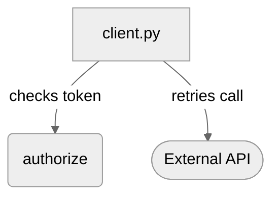

<!-- lemoncrow:summary v1 -->
Re-review: comment `@lemoncrow review`

<h2>Confidence Score: 5/5</h2>

---

**[Medium impact]** Adds retries and a token check to the checkout client
payments code, concurrency or shared state · 3 files, 80 changed lines · from the change itself, not a model

**No must-fix findings**

Reviewed 80 changed lines in 3 files · 0 new

### Summary

The checkout client now retries failed calls and checks the caller's token first.

- Retries a failed payment call up to three times
- Rejects a request whose token is missing before it reaches the gateway
- Logs the outcome of each attempt

### Diagram

Sketched by the model from the diff. Every box is a changed file, a changed symbol or a generic actor; the arrows are its reading of the change and are not checked against the code.

<!-- /lemoncrow:diagram -->

### What we checked

- Files: 3 files (`src/auth.py`, `src/cache.py`, `src/client.py`)
- Targets in this change: 4; risk signals: 3; investigated by the model: 3
- Rules applied: `no-secrets-in-logs`
- Depth: Auto

---
Reviews (1) · Last reviewed commit: [Retry the checkout call](https://github.com/acme/widgets/commit/aaaaaaaaaaaaaaaaaaaaaaaaaaaaaaaaaaaaaaaa) · Reviewed by [LemonCrow](https://lemoncrow.com) openai/gpt-4o-mini · Auto · this review: 3 model calls, 3.1k tokens, est. $0.0007
