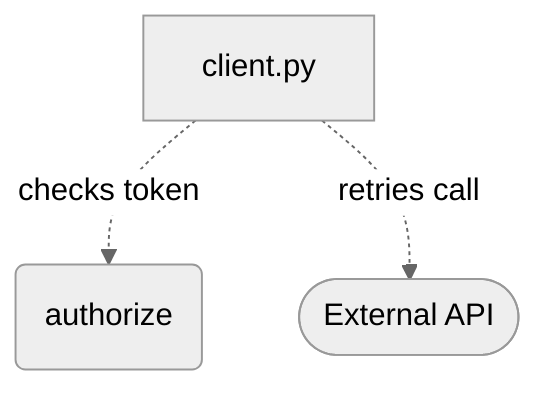

<!-- lemoncrow:summary v1 -->
Re-review: comment `@lemoncrow review`

<h2>No must-fix in the part reviewed</h2>

**Partially reviewed: 1 of 3 risk signals examined** · Human review required: touches payments code

**Risk: High · authorize is access-control code · and 1 more**
Checked on commit aaaaaaa · 3 files, 80 changed lines · Risk is measured from the change and the run record, not a model

---

Adds retries and a token check to the checkout client

Reviewed 80 changed lines in 3 files · 0 new · 2 risk signals not investigated yet

### Summary

The checkout client now retries failed calls and checks the caller's token first.

- Retries a failed payment call up to three times
- Rejects a request whose token is missing before it reaches the gateway
- Logs the outcome of each attempt

### Diagram

Sketched by the model from the diff. Every box is a changed file, a changed symbol or a generic actor; the dashed arrows are its reading of the change: inferred, not checked against the code.

<!-- /lemoncrow:diagram -->

### What we checked

- Files: 3 files (`src/auth.py`, `src/cache.py`, `src/client.py`)
- Targets in this change: 4; risk signals: 3; investigated by the model: 3
- Rules applied: `no-secrets-in-logs`
- Depth: Auto

### What was not checked

- Tests: no CI run was reported on this commit
- Not measured: callers of the changed code (no code index)
- Not measured: which tests exercise the changed code
- Changed code: 2 risk signals not investigated by the model yet
- Callers in other repositories: none were searched

---
Independence: reviewer OpenAI (`gpt-4o-mini`) · author unknown (no coding agent declared in the commits) · **unknown** Reviews (1) · Last reviewed commit: [Retry the checkout call](https://github.com/acme/widgets/commit/aaaaaaaaaaaaaaaaaaaaaaaaaaaaaaaaaaaaaaaa) · Reviewed by [LemonCrow](https://lemoncrow.com) openai/gpt-4o-mini · Auto · this review: 3 model calls, 3.1k tokens, est. $0.0007
