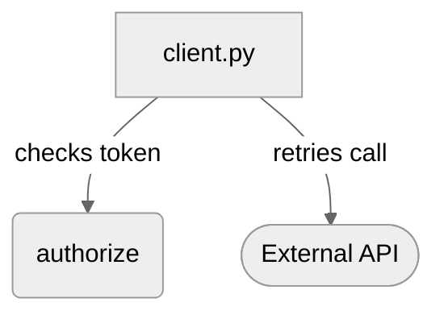

<!-- lemoncrow:summary v1 -->
<sub>Re-review: comment `@lemoncrow review`</sub>

<h2>Confidence Score: 1/5</h2>

---

**[Medium impact]** Adds retries and a token check to the checkout client
<sub>payments code, concurrency or shared state · 3 files, 80 changed lines · from the change itself, not a model</sub>

**1 must-fix before merge** · 1 should-fix

<sub>Re-reviewed 22 changed lines · 1 new · 1 carried forward · 1 fixed since last review</sub>

### Findings

1.  **[Token is logged in clear text](https://github.com/acme/widgets/pull/7#discussion_r1)** — `src/auth.py:31` · new
   <sub>**Rule used:** `no-secrets-in-logs`</sub>
2.  **[Retry loop never gives up](https://github.com/acme/widgets/pull/7#discussion_r2)** — `src/client.py:40-44` · carried forward
   <sub>**Context used:** `src/handlers.py:12-18` (caller)</sub>

### Summary

The checkout client now retries failed calls and checks the caller's token first.

- Retries a failed payment call up to three times
- Rejects a request whose token is missing before it reaches the gateway
- Logs the outcome of each attempt

### Diagram



<sub>Sketched by the model from the diff. Every box is a changed file, a changed symbol or a generic actor; the arrows are its reading of the change and are not checked against the code.</sub>

<!-- /lemoncrow:diagram -->

<details><summary>Fix with agent prompt</summary>

Paste this into Claude Code, Codex or Cursor, in a checkout of this branch.

```text
Fix the open review findings on pull request #7 (acme/widgets) at commit aaaaaaa.
For each one: open the file at the location, confirm the problem is real, make the smallest change that fixes
it, and run the project's tests. If a finding is wrong, say why and leave the code alone. Change nothing else.

1. [P0] src/auth.py:31 - Token is logged in clear text
   Why: The changed branch returns before it rejects a missing principal.
   Consequence: An unauthenticated request can reach behaviour meant for administrators.
2. [P1] src/client.py:40-44 - Retry loop never gives up
   Why: The changed branch returns before it rejects a missing principal.
   Consequence: An unauthenticated request can reach behaviour meant for administrators.
```

</details>

<details><summary>1 finding fixed since last review</summary>

-  ~~Missing principal accepted~~ — `src/auth.py:12-14` · fixed in 9f8e7d6

</details>

---
<sub>Reviews (2) · Last reviewed commit: [Retry the checkout call](https://github.com/acme/widgets/commit/aaaaaaaaaaaaaaaaaaaaaaaaaaaaaaaaaaaaaaaa) · Reviewed by [LemonCrow](https://lemoncrow.com)<br>openai/gpt-4o-mini · Auto · this review: 3 model calls, 3.1k tokens, est. $0.0007 · all 2 reviews: 6 model calls, 6.2k tokens, est. $0.0014</sub>
